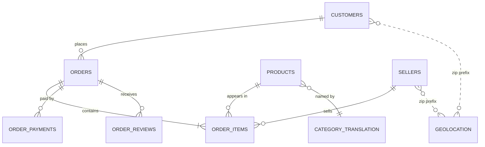

# 🛒 Olist E-Commerce Analytics — SQL Case Files


> A SQL-first analysis of **~100k Brazilian marketplace orders (2016–2018)**: from raw CSVs to a clean data model and business insights — solved as 122 story-driven cases.

---

## 🎯 Business problem

Olist connects small Brazilian sellers to large marketplaces. Leadership wants to know:

1. **Growth** — is the business growing, and is the growth healthy (new vs returning customers)?
2. **Operations** — where and why do deliveries run late, and what does it cost in customer satisfaction?
3. **Customers** — who are the valuable customers, and why do so few come back?
4. **Sellers & products** — which sellers/categories drive value, and where is the risk?

*(Replace/extend these with your own sharper questions as you progress. The 122 SQL cases in `docs/02_SQL_PROBLEM_BANK.md` are written as a story: you are the new analyst, and each stakeholder asks one of these questions.)*

---

## 🧰 Tech stack

| Layer | Tool |
|---|---|
| Storage & modelling | PostgreSQL 18 (DBeaver) |
| Analysis | SQL — joins, CTEs, window functions, cohorts, star schema |
| Editor | VS Code (for `.sql` files and Markdown) |
| Version control | Git + GitHub (GitHub Flow, conventional commits) |

---

## 🗂️ Repository structure

```text
olist-analytics/
├── START_HERE.md                ← what's inside + how to use this folder
├── README.md                    ← you are here
├── .gitignore
├── .github/                     ← PR + issue templates
├── docs/
│   ├── 00_DBEAVER_DATABASE_AND_UPLOAD_GUIDE.md  ← create a DB + upload ANY dataset
│   ├── 01_GIT_GITHUB_GUIDE.md   ← learn the workflow
│   ├── 02_SQL_PROBLEM_BANK.md   ← 122 story-driven business cases
│   └── 03_DATA_DICTIONARY.md    ← tables, grain, traps
├── data/
│   └── raw/                     ← CSVs (git-ignored; see data/README.md)
├── sql/
│   ├── 00_setup/                ← inspect → build clean schema → keys/indexes
│   └── solutions/               ← one folder per chapter (m00 … m12), each with a README case tracker
│       └── 00_solution_template.sql        ← documentation standard for every solution
├── reports/chapter_notes/       ← one story-format note per chapter
├── reports/insights/            ← capstone one-pagers (portfolio gold)
└── reports/figures/             ← screenshots/charts used in this README
```

---

## 🧩 Data model



---

## 🚀 Reproduce it yourself

<details open><summary><b>1. Create the database and upload the CSVs</b></summary>

Download the dataset from Kaggle: [Brazilian E-Commerce Public Dataset by Olist](https://www.kaggle.com/datasets/olistbr/brazilian-ecommerce), unzip the 9 CSVs into `data/raw/` (git-ignored), then follow **[`docs/00_DBEAVER_DATABASE_AND_UPLOAD_GUIDE.md`](docs/00_DBEAVER_DATABASE_AND_UPLOAD_GUIDE.md)**:

```text
CREATE DATABASE olist_db;  ->  CREATE SCHEMA raw; CREATE SCHEMA olist;  ->  import the 9 CSVs into schema raw (DBeaver wizard)
```
</details>

<details><summary><b>2. Build the clean analysis schema</b></summary>

```text
1. sql/00_setup/00_inspect_loaded_tables.sql   -> see what the import created (names, types, counts)
2. sql/00_setup/01_build_clean_schema.sql      -> builds schema `olist` (typed tables) from schema `raw`
3. sql/00_setup/02_keys_indexes.sql            -> primary keys + indexes + ANALYZE
(optional) sql/00_setup/tools/profile_table.sql -> reusable column profiler for any table
```
All analysis queries start with `SET search_path TO olist, public;`
</details>

---

## 📈 Progress tracker

| Chapter | Story | Cases | Status |
|---|---|---:|---|
| 0 | Day One: Trust Nothing | 9 | ⬜ |
| 1 | Board Meeting Friday | 12 | ⬜ |
| 2 | The Case of the Inflated Revenue | 10 | ⬜ |
| 3 | The Monday Ops Review | 11 | ⬜ |
| 4 | Code Review with Marina | 8 | ⬜ |
| 5 | The Board's Favourite Charts | 12 | ⬜ |
| 6 | Black Friday & Messy Data | 8 | ⬜ |
| 7 | Where Did the Customers Go? | 10 | ⬜ |
| 8 | The Seller Quality Crisis | 10 | ⬜ |
| 9 | Merchandising Strategy | 9 | ⬜ |
| 10 | The Voice of the Customer | 6 | ⬜ |
| 11 | Building the Platform | 9 | ⬜ |
| 12 | Board Meeting: The Final Cases | 8 | ⬜ |

*Legend: ⬜ not started · 🟨 in progress · ✅ done*

---

## 🔍 Key insights *(fill in as you discover — recruiters read this section first)*

| # | Finding | Evidence (number) | Recommendation |
|---|---|---|---|
| 1 | _e.g. Only ~3% of customers ever place a second order_ | _Q7.1: x%_ | _Invest in retention, not just acquisition_ |
| 2 | | | |
| 3 | | | |

---

## 🗺️ Roadmap

- [x] Repository & database setup
- [ ] Chapters 0–4: data audit, KPIs, joins, operations metrics, clean SQL
- [ ] Chapters 5–8: window functions, dates & text, customer retention, sellers & logistics
- [ ] Chapters 9–11: merchandising, customer experience, star schema & performance
- [ ] Chapter 12: capstone one-pagers in `reports/insights/`

---

## 🧑‍💻 Author

**Your Name** · [LinkedIn](https://linkedin.com/in/your-profile) · [GitHub](https://github.com/your-username)

*Dataset © Olist, released under CC BY-NC-SA 4.0 on Kaggle. This repo contains analysis code only, not the raw data.*
