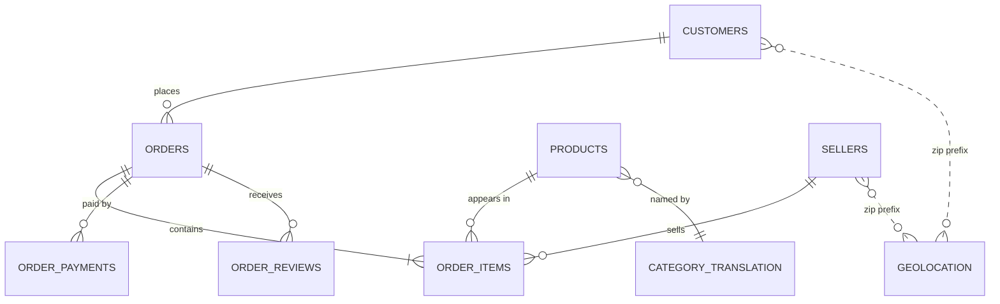

# 🛒 Olist E-Commerce Analytics — SQL Learning & Project Portfolio


> **One repo, two goals:** (1) learn SQL end-to-end by working through **122 story-driven business cases**, and (2) turn the strongest work into **portfolio projects** with real findings on **~100k Brazilian marketplace orders (2016–2018)**.

> 🚧 **Status: in progress** · started October 2026 · setup ✅ · chapters **0 / 13** · projects **0 / 5**.
> The tracker below is updated as I work. It shows what is done, not what is planned.

---

## 👀 For reviewers: the 2-minute tour

| If you want to see… | Look here |
|---|---|
| **Findings and recommendations** | [Key insights](#-key-insights) below · [`reports/insights/`](reports/insights/) |
| **The 5 portfolio projects** and their status | [`docs/PROJECTS.md`](docs/PROJECTS.md) |
| **How I document and validate SQL** | [`sql/solutions/00_solution_template.sql`](sql/solutions/00_solution_template.sql) (standard) · [`Q1.4` worked example](sql/solutions/m01_kpis/Q1.4_monthly_trend_EXAMPLE.sql) (reference example, *not* one of my solutions) |
| **How I learn** (mistakes included) | [`reports/learning_log.md`](reports/learning_log.md) · [`reports/chapter_notes/`](reports/chapter_notes/) |
| **That it is reproducible** | [`sql/00_setup/`](sql/00_setup/) · [`docs/DATA_DICTIONARY.md`](docs/DATA_DICTIONARY.md) |

---

## 🧭 Two tracks

| | 📚 Learning track | 🏆 Project track |
|---|---|---|
| **Purpose** | Build skills, case by case | Show finished, decision-ready analysis |
| **Material** | [Problem Bank](docs/SQL_PROBLEM_BANK.md) (122 cases, 13 chapters), [guides](docs/guides/) | [5 projects](docs/PROJECTS.md) built from the cases |
| **Output** | `sql/solutions/` + chapter notes + learning log | One-pager in `reports/insights/` + chart + row in Key insights |
| **Quality bar** | Correct, documented, validated | All of that, plus a recommendation with numbers |

Not every case gets a polished write-up. The project track picks the cases that tell a complete business story.

---

## 🤝 How this was built

The case bank, setup scripts and guides were **designed with AI assistance (Claude)** to give me a structured curriculum. The **SQL solutions, validation, charts, chapter notes, learning log and insights** in `sql/solutions/` and `reports/` are **my own work**; I use AI only to critique finished answers, never to write them first.

---

## 🎯 Business problem

Olist connects small Brazilian sellers to large marketplaces. Leadership wants to know:

1. **Growth**: is the business growing, and is the growth healthy (new vs returning customers)?
2. **Operations**: where and why do deliveries run late, and what does it cost in customer satisfaction?
3. **Customers**: who are the valuable customers, and why do so few come back?
4. **Sellers & products**: which sellers and categories drive value, and where is the risk?

The cases are written as a story: I play the new analyst and each stakeholder (CEO, CFO, COO…) asks one of these questions. *The company and people are fictional; the data is real.*

---

## 🧠 Skills practised

| Skill | Chapter(s) | Status |
|---|---|---|
| Data auditing: grain, keys, orphans, NULLs | 0 | ⬜ |
| KPI definition and reporting | 1 | ⬜ |
| Joins and fan-out control | 2 | ⬜ |
| Operational metrics: conditional aggregation, percentiles | 3 | ⬜ |
| Subqueries, `EXISTS`, CTE design | 4 | ⬜ |
| Window functions: ranking, running totals, YoY | 5 | ⬜ |
| Dates, text cleaning, NULL handling | 6 | ⬜ |
| Cohorts, retention, RFM, lifetime value | 7 | ⬜ |
| Seller scorecards and logistics | 8 | ⬜ |
| Merchandising: Pareto, basket analysis, pricing | 9 | ⬜ |
| Review and NPS analysis | 10 | ⬜ |
| Data modelling and performance: star schema, views, `EXPLAIN` | 11 | ⬜ |
| Business storytelling (Headline → Evidence → Action) | every case, 12 | ⬜ |

---

## 🧰 Tech stack

| Layer | Tool |
|---|---|
| Storage & modelling | PostgreSQL 18 (DBeaver) |
| Analysis | SQL: joins, CTEs, window functions, cohorts, star schema |
| Editor | VS Code (for `.sql` files and Markdown) |
| Version control | Git + GitHub (GitHub Flow, conventional commits, one PR per chapter) |

---

## 🗂️ Repository structure

```text
olist-analytics/
├── README.md                    ← you are here
├── START_HERE.md                ← navigation for reviewers and for anyone following along
├── LICENSE
├── .gitignore
├── .github/                     ← pull-request + issue templates
├── docs/
│   ├── SQL_PROBLEM_BANK.md      ← 122 story-driven business cases
│   ├── PROJECTS.md              ← the 5 portfolio projects + "showcase-ready" checklist
│   ├── DATA_DICTIONARY.md       ← tables, grain, join map, data traps
│   └── guides/
│       ├── DBEAVER_DATABASE_AND_UPLOAD_GUIDE.md   ← create a DB + upload ANY dataset
│       └── GIT_GITHUB_GUIDE.md                    ← Git + GitHub, zero to professional workflow
├── data/raw/                    ← CSVs (git-ignored; see data/README.md)
├── sql/
│   ├── 00_setup/                ← inspect → build clean schema → keys/indexes
│   └── solutions/               ← one folder per chapter (m00 … m12) with a case tracker
├── reports/
│   ├── learning_log.md          ← dated notes: what I learned, what broke
│   ├── chapter_notes/           ← one short story-format note per chapter
│   ├── insights/                ← project one-pagers
│   └── figures/                 ← charts and diagrams used in the write-ups
```

---

## 🧩 Data model



---

## 🚀 Reproduce it yourself

<details open><summary><b>1. Create the database and upload the CSVs</b></summary>

Download the dataset from Kaggle: [Brazilian E-Commerce Public Dataset by Olist](https://www.kaggle.com/datasets/olistbr/brazilian-ecommerce), unzip the 9 CSVs into `data/raw/` (git-ignored), then follow **[`docs/guides/DBEAVER_DATABASE_AND_UPLOAD_GUIDE.md`](docs/guides/DBEAVER_DATABASE_AND_UPLOAD_GUIDE.md)**:

```text
CREATE DATABASE olist_db;  ->  CREATE SCHEMA raw; CREATE SCHEMA olist;  ->  import the 9 CSVs into schema raw (DBeaver wizard)
```
</details>

<details><summary><b>2. Build the clean analysis schema</b></summary>

```text
1. sql/00_setup/00_inspect_loaded_tables.sql   -> see what the import created (names, types, counts)
2. sql/00_setup/01_build_clean_schema.sql      -> builds schema `olist` (typed tables) from schema `raw`
3. sql/00_setup/02_keys_indexes.sql            -> primary keys + indexes + ANALYZE
(optional) sql/00_setup/tools/profile_table.sql -> reusable column profiler for any table
```
All analysis queries start with `SET search_path TO olist, public;`
</details>

---

## 📈 Progress

### Learning track: chapters

| Chapter | Story | Cases | Status |
|---|---|---:|---|
| 0 | Day One: Trust Nothing | 9 | ⬜ |
| 1 | Board Meeting Friday | 12 | ⬜ |
| 2 | The Case of the Inflated Revenue | 10 | ⬜ |
| 3 | The Monday Ops Review | 11 | ⬜ |
| 4 | Code Review with Marina | 8 | ⬜ |
| 5 | The Board's Favourite Charts | 12 | ⬜ |
| 6 | Black Friday & Messy Data | 8 | ⬜ |
| 7 | Where Did the Customers Go? | 10 | ⬜ |
| 8 | The Seller Quality Crisis | 10 | ⬜ |
| 9 | Merchandising Strategy | 9 | ⬜ |
| 10 | The Voice of the Customer | 6 | ⬜ |
| 11 | Building the Platform | 9 | ⬜ |
| 12 | Board Meeting: The Final Cases | 8 | ⬜ |

*Legend: ⬜ not started · 🟨 in progress · ✅ done*

### Project track

| # | Project | Business question | Status |
|---|---|---|---|
| P1 | Growth & trusted KPIs | Is growth really slowing, and can we trust the numbers? | ⬜ |
| P2 | Late deliveries | Where do deliveries run late, and how do we cut them by 30%? | ⬜ |
| P3 | Retention & marketing | Why do so few customers come back, and where should marketing spend? | ⬜ |
| P4 | Seller quality | Which sellers should we coach, and which should we drop? | ⬜ |
| P5 | Analytics data model | Can we turn the raw tables into a fast, reusable star schema? | ⬜ |

Details, case lists and deliverables: [`docs/PROJECTS.md`](docs/PROJECTS.md).

---

## 🔍 Key insights

*A row is added only when it is backed by a validated query. Empty means "not yet", never "assumed".*

| # | Finding | Evidence (number) | Recommendation | Project |
|---|---|---|---|---|
| 1 | _pending_ | | | |
| 2 | _pending_ | | | |
| 3 | _pending_ | | | |

---

## 🗺️ Roadmap

- [x] Repository, database and clean schema set up
- [ ] Chapters 0–4: data audit, KPIs, joins, operations metrics, clean SQL → **P1**
- [ ] Chapters 5–8: window functions, dates & text, retention, sellers & logistics → **P2, P3, P4**
- [ ] Chapters 9–11: merchandising, customer experience, star schema & performance → **P5**
- [ ] Chapter 12: capstone one-pagers in `reports/insights/`

---

## 📄 License & credits

- **My code and original documentation:** [MIT](LICENSE).
- **Dataset:** [Brazilian E-Commerce Public Dataset by Olist](https://www.kaggle.com/datasets/olistbr/brazilian-ecommerce), © Olist, released under CC BY-NC-SA 4.0. The raw data is **not** included in this repo (analysis code only).

## 🧑‍💻 Author

**MD FAHIM HASAN JALANEY** · [LinkedIn](www.linkedin.com/in/
md-fahim-hasan-jalaney) · [GitHub](https://github.com/fahimhasan-data)
