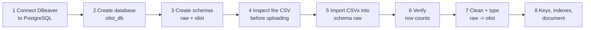

# 🗄️ DBeaver + PostgreSQL 18 — Create a Database and Upload ANY Dataset

> **Goal:** after this guide you can create a database, bring any CSV dataset into it, check that nothing was lost, and clean it — on your own, for any project, any time.
> First we do it with the **Olist** dataset (your current project). Then Part 9 turns it into a **universal routine** for every future dataset.
> Tested with: PostgreSQL 18 · DBeaver (recent version) · Windows. Mac/Linux notes are included.

---

## ⚡ The 60-second overview



**The one idea to remember — "land it raw, then clean it in SQL":**
you first copy the file into the database *exactly as it is* (schema `raw`, everything safe), and only then build clean, correctly-typed tables (schema `olist`) with SQL. If you make a mistake while cleaning, the raw data is untouched and you can simply re-run. This is how professional data teams work (they call it *staging* or the *bronze → silver* pattern).

---

## 🧠 Part 0 — Four words you must know

| Term | Meaning | Analogy |
|---|---|---|
| **Server** | The PostgreSQL program running on your PC (port **5432**) | The building |
| **Database** | A separate container inside the server (e.g. `olist_db`) | A floor in the building |
| **Schema** | A folder inside a database (e.g. `raw`, `olist`) | A room on the floor |
| **Table** | Rows and columns of data | A spreadsheet in the room |

A full table name looks like `database.schema.table`. Inside one database you write `schema.table`, e.g. `raw.olist_orders_dataset`.

**Why a new database per project?** Clean separation: `olist_db` for this project, another one for the next. Nothing mixes.

---

## 🔌 Part 1 — Make sure PostgreSQL 18 is running and connect DBeaver (one-time)

### 1.1 Is the server running? (Windows)
1. Press `Win + R` → type `services.msc` → Enter.
2. Find a service named like **`postgresql-x64-18`**. Status must be **Running**. If not: right-click → **Start**.

*(Mac: `brew services list` · Linux: `sudo systemctl status postgresql`)*

You need three facts from when you installed PostgreSQL: **port** (default `5432`), **user** (`postgres`) and the **password you set**. Forgot the password? Search "reset postgres password Windows pg_hba.conf" — it's a 5-minute fix, don't reinstall.

### 1.2 Create the DBeaver connection
1. DBeaver → top-left plug icon **New Database Connection** (or `Ctrl+Shift+N`).
2. Choose **PostgreSQL** → *Next*.
3. Fill in:

| Field | Value |
|---|---|
| Host | `localhost` |
| Port | `5432` |
| Database | `postgres` *(the default admin database — we'll create ours next)* |
| Username | `postgres` |
| Password | *(yours)* ☑ Save password |

4. Click **Test Connection**.
   - First time, DBeaver asks to **download the PostgreSQL driver** → click **Download**. (Needs internet once.)
   - ✅ You should see **"Connected"**.
5. Click **Finish**. Your connection appears in the **Database Navigator** on the left.

> ✅ **Checkpoint 1:** you can expand the connection → *Databases* → `postgres` → *Schemas* → `public`.

---

## 🏗️ Part 2 — Create the database `olist_db`

### Method A — with SQL (recommended; you learn the command)
1. Click your connection `postgres` → press `Ctrl+]` (new SQL script) or menu **SQL Editor → New SQL script**.
2. Run:
```sql
CREATE DATABASE olist_db ENCODING 'UTF8';
```
Run it with `Ctrl+Enter`. (DBeaver must be in **Auto-commit** mode — the default. The toolbar shows *Auto*. `CREATE DATABASE` cannot run inside a manual transaction.)

### Method B — with the mouse
Navigator → expand your connection → right-click **Databases** → **Create New Database** → Name `olist_db` → Encoding `UTF8` → OK.

### Make the new database visible and connect to it
DBeaver shows only the one database you connected to. Two ways to work in `olist_db`:

- **Option 1 (cleanest):** create a **second connection** exactly like in 1.2 but with **Database = `olist_db`**. Name it `olist_db` (right-click connection → *Rename*, or on the *General* tab). Use this connection for all Olist work.
- **Option 2:** right-click your connection → **Edit Connection** → *PostgreSQL* tab → ☑ **Show all databases** → OK → press `F5` on the connection to refresh.

> ✅ **Checkpoint 2:** under the `olist_db` connection you see *Databases → olist_db → Schemas → public*. Open a new SQL script on **this** connection and run `SELECT current_database();` — it must say `olist_db`.

---

## 🗂️ Part 3 — Create the schemas

In an SQL script on the **`olist_db`** connection, run (select all → `Alt+X` = execute script):

```sql
CREATE SCHEMA IF NOT EXISTS raw;     -- landing zone: files exactly as they arrived
CREATE SCHEMA IF NOT EXISTS olist;   -- clean, typed tables for analysis
```
Right-click **Schemas** in the navigator → **Refresh** (or `F5`). You should see `raw` and `olist`.

> 💡 Why not use `public`? It works, but a dedicated `raw` schema keeps untouched files separate from your cleaned tables, so you always know what is original.

---

## 🔍 Part 4 — Inspect the CSV *before* you upload (5-minute habit)

Never import blindly. Open each CSV in **VS Code** (or Notepad++) and check:

| Look for | Why it matters | Olist answer |
|---|---|---|
| **Delimiter** (`,` `;` tab `\|`) | Wrong delimiter = everything in one column | Comma `,` |
| **Header row** (first line = column names?) | Otherwise the header is imported as data | Yes |
| **Quotes** around text with commas/newlines | Review comments contain commas and line breaks | `"` quote char |
| **Empty values** | Should become NULL, not empty text | Empty = missing |
| **Encoding** | Accents (`São Paulo`) break if wrong | UTF-8 |
| **Date format** | `2018-01-31` vs `31/01/2018` | `YYYY-MM-DD HH:MM:SS` |
| **Size** | Big files take longer | `geolocation` ≈ 1M rows (≈ 60 MB) |

**Your 9 files:**
```
olist_customers_dataset.csv          olist_orders_dataset.csv
olist_geolocation_dataset.csv        olist_order_payments_dataset.csv
olist_order_items_dataset.csv        olist_order_reviews_dataset.csv
olist_products_dataset.csv           olist_sellers_dataset.csv
product_category_name_translation.csv
```
Keep them in `olist-analytics/data/raw/` (Git ignores this folder — see the Git guide).

---

## 📥 Part 5 — Import the CSVs with the DBeaver wizard

### 5.1 Open the wizard
Navigator → `olist_db` → **Schemas → raw → Tables** → **right-click `Tables` → Import Data**.

### 5.2 Walk through the wizard

**Step 1 – Import source:** choose **CSV** → *Next*.

**Step 2 – Input file(s):** select your CSV file(s). 👉 You can select **all 9 files at once** (hold `Ctrl` or press `Ctrl+A` in the file dialog); DBeaver creates one table per file, named after the file. *(If your DBeaver version only accepts one file, repeat the whole wizard 9 times.)*

**Step 3 – Importer settings (the most important page):**

| Setting | Value | Notes |
|---|---|---|
| Encoding | **UTF-8** | |
| Column delimiter | `,` | Excel in some regions saves `;` — change if needed |
| Header position | **top** | first line = column names |
| Quote char | `"` | |
| Escape char | `"` or leave default | |
| NULL value mark | *(leave empty)* | |
| ☑ **Set empty strings to NULL** | **ON** | empty cells become real NULLs |
| Date/time format | leave default | we convert in SQL later |
| Sample/rows to detect types | default | |

Use the **preview** at the bottom: columns must be split correctly and accents must look right (`São`, not `São`). If not, fix the delimiter/encoding **now**.

**Step 4 – Tables mapping:**
- **Target container** must be **`olist_db → raw`** (click *Choose…* if it isn't).
- For each file the *Mapping* column should say **`create`** (a new table).
- Click a row and press **Columns…** to see the data types DBeaver guessed. **You don't have to perfect them** — our script `01_build_clean_schema.sql` converts any type to the right one. (Leaving everything as `text` is perfectly fine and the safest.)
- Keep the table names DBeaver proposes (e.g. `olist_orders_dataset`) — the setup scripts expect these.

**Step 5 – Data load settings:**

| Setting | Value |
|---|---|
| ☐ Truncate target table before load | **OFF** the first time. **ON** if you re-import (otherwise rows are duplicated!) |
| ☑ Use transactions | ON |
| ☑ Open new connection(s) | ON |
| Use bulk load / multi-row insert | leave defaults |
| Everything else | leave defaults |

**Step 6 – Confirm → Proceed.** DBeaver shows progress and a notification when done. Small tables take seconds; `geolocation` (~1M rows) takes a few minutes. Let it finish.

> ✅ **Checkpoint 3:** `F5` on *raw → Tables* — nine tables are listed.

---

## ✔️ Part 6 — Verify (don't trust the progress bar!)

Open a SQL script on `olist_db` and run `sql/00_setup/00_inspect_loaded_tables.sql` (block C):

```sql
SELECT 'customers' AS tbl, COUNT(*) FROM raw.olist_customers_dataset
UNION ALL SELECT 'orders', COUNT(*) FROM raw.olist_orders_dataset
UNION ALL SELECT 'order_items', COUNT(*) FROM raw.olist_order_items_dataset;
-- ... (the file has all 9)
```

| Table | Expected rows (approx.) |
|---|---:|
| orders | 99,441 |
| customers | 99,441 |
| order_items | 112,650 |
| order_payments | 103,886 |
| order_reviews | ~99,224 |
| products | 32,951 |
| sellers | 3,095 |
| category_translation | 71 |
| geolocation | ~1,000,163 |

*A few rows off? Compare with the CSV: open in VS Code and look at the last line number (minus 1 for the header — but multi-line review comments make `order_reviews` line counts larger than row counts, so for that file trust the database count, not the line count).*

> ✅ **Checkpoint 4:** the counts match. If one table is far too small or empty, re-import that table with *Truncate before load* ON.

---

## 🧼 Part 7 — Olist: convert raw → clean (3 scripts)

Run these in order, each with **Execute Script (`Alt+X`)**, on the `olist_db` connection:

| # | Script (in `sql/00_setup/`) | What it does |
|---|---|---|
| 1 | `00_inspect_loaded_tables.sql` | Shows tables, types and counts (read-only) |
| 2 | `01_build_clean_schema.sql` | Creates typed tables in schema `olist` from `raw` (re-runnable) |
| 3 | `02_keys_indexes.sql` | Adds primary keys + indexes, runs `ANALYZE` |

The build script expects schema **`raw`** and the default table names. If your tables landed somewhere else, edit only the **EDIT HERE** block at the top of script 2.

**Final check:**
```sql
SET search_path TO olist, public;
SELECT COUNT(*) FROM orders;            -- same as raw.olist_orders_dataset
SELECT order_purchase_timestamp FROM orders LIMIT 3;   -- real timestamps now
```
🎉 You are ready for **Chapter 0** of the Problem Bank.

---

## 🌍 Part 8 — Why "everything as text first" is a professional habit

If DBeaver (or any tool) *guesses* a type wrong, you can lose information silently:

| Raw value | Wrongly guessed as | Damage |
|---|---|---|
| `01046` (zip code) | integer | leading zero lost |
| `03/04/2018` | date (mm/dd) | day and month swapped |
| `1,234.50` | number | import fails or becomes `1` |
| `00123` (id) | integer | ids stop matching |

When everything lands as text, **nothing is lost or guessed**; you then convert deliberately with SQL, where you can inspect problems (`WHERE col !~ '^\d+$'`) before casting.

---

## 🧰 Part 9 — The Universal Routine: upload ANY dataset yourself

Copy this checklist into every new project. ☐ = tick it.

### The 10-step data onboarding routine

| # | Step | How |
|---|---|---|
| 1 | ☐ **Create the database** | `CREATE DATABASE project_db ENCODING 'UTF8';` then connect to it |
| 2 | ☐ **Create schemas** | `CREATE SCHEMA raw; CREATE SCHEMA clean;` (name them as you like) |
| 3 | ☐ **Inspect files** | open in VS Code: delimiter, header, quotes, encoding, dates |
| 4 | ☐ **Import to `raw`** | DBeaver → `raw → Tables → Import Data → CSV` (settings from Part 5) |
| 5 | ☐ **Verify counts** | row counts vs. file; look at 10 sample rows |
| 6 | ☐ **Profile columns** | run the *column sniffer* (below) on every table |
| 7 | ☐ **Build clean tables** | `CREATE TABLE clean.x AS SELECT … ::type …` (template below) |
| 8 | ☐ **Keys & indexes** | primary keys where unique; indexes on join columns; `ANALYZE` |
| 9 | ☐ **Validate** | row counts raw = clean; spot-check totals; NULL counts |
| 10 | ☐ **Document & commit** | data dictionary + scripts to Git (not the data!) |

### 🔬 The column sniffer (tool included in the repo)
Run `sql/00_setup/tools/profile_table.sql` **once per database**, then:

```sql
SELECT * FROM public.profile_table('raw', 'olist_orders_dataset');
```
You get, per column: rows, empty/NULL count, distinct values, longest value, and a **suggested data type**:

| column_name | n_rows | n_empty_or_null | n_distinct | max_length | suggested_type |
|---|---:|---:|---:|---:|---|
| order_purchase_timestamp | 99441 | 0 | 98875 | 19 | timestamp / date |
| order_approved_at | 99441 | 160 | 90733 | 19 | timestamp / date |
| order_id | 99441 | 0 | 99441 | 32 | text |

*(Numbers above are illustrative.)* A column whose `n_distinct` equals `n_rows` is a **candidate primary key**.

### 🧪 The raw → clean template (adapt for any table)

```sql
CREATE TABLE clean.my_table AS
SELECT
    id::text                                         AS id,           -- identifiers stay TEXT
    NULLIF(quantity::text, '')::numeric::integer     AS quantity,     -- int  (handles '1.0' too)
    NULLIF(price::text, '')::numeric(12,2)           AS price,        -- money
    NULLIF(created_at::text, '')::timestamp          AS created_at,   -- date/time
    NULLIF(trim(city::text), '')                     AS city          -- text with blanks -> NULL
FROM raw.my_table;
```
Rules: **ids stay text** · wrap every non-text column in `NULLIF(col::text,'')` first · give columns clean `snake_case` names · never edit the raw table.

For **non-standard dates** like `31/01/2018`: `to_date(col, 'DD/MM/YYYY')`; for `1.234,50` style numbers: `replace(replace(col,'.',''),',','.')::numeric`.

### ⚡ Method B — `psql \copy` (fastest for very large files)
Open **SQL Shell (psql)** (installed with PostgreSQL), connect to `olist_db`, then:
```sql
CREATE TABLE raw.demo (id text, name text, price text);          -- create the table first (all text)
\copy raw.demo FROM 'C:/Users/YOU/data/demo.csv' WITH (FORMAT csv, HEADER true)
```
Use forward slashes in Windows paths. `\copy` reads the file on **your** PC; plain `COPY` reads on the **server** and needs special rights, so avoid it. `\copy` works only in psql, **not** in DBeaver's SQL editor.

### 📄 Other file types
Recent DBeaver versions also import **XLSX, JSON and XML** (the *Import source* list in step 1 shows what yours supports). If your type isn't listed, save/export it as **CSV (UTF-8)** from Excel and import that. For Excel, make sure dates are saved in an unambiguous format.

---

## 🛠️ Part 10 — Troubleshooting table

| Problem / message | Likely cause | Fix |
|---|---|---|
| *Connection refused* | PostgreSQL service stopped, wrong port | Start service in `services.msc`; check port 5432 |
| *password authentication failed for user "postgres"* | Wrong password | Re-enter; or reset password |
| *database "olist_db" does not exist* | Connected to the wrong database / not created | Check `SELECT current_database();`; create it (Part 2) |
| Driver download fails | No internet / proxy | Connect to internet once; or DBeaver → *Database → Driver Manager → PostgreSQL → Download* |
| Connection error mentioning an unsupported server version | Old PostgreSQL JDBC driver | Update DBeaver, or *Driver Manager → PostgreSQL → Update version* |
| `CREATE DATABASE cannot run inside a transaction block` | Manual-commit mode | Switch toolbar to **Auto** commit |
| Everything lands in **one column** | Wrong delimiter | Change *Column delimiter* (`;` or tab) in importer settings |
| `São Paulo` shows as `São Paulo` | Wrong encoding | Set *Encoding* to UTF-8 (or Windows-1252/ISO-8859-1 for older files) |
| *invalid byte sequence for encoding "UTF8"* | File isn't UTF-8 | Re-save file as UTF-8, or select the right encoding |
| Header imported as a data row | Header position wrong | Set *Header position* = top |
| Row counts **doubled** | Imported twice | `TRUNCATE raw.table;` then re-import (or tick *Truncate before load*) |
| Import very slow | Large file via GUI | Use Method B (`\copy`) |
| Review comments split across rows | Quote character wrong | Set quote char to `"` |
| Leading zeros vanished | Column typed as integer | Import as text (Part 8) |
| `relation "orders" does not exist` | Wrong schema in search path | Run `SET search_path TO olist, public;` or write `olist.orders` |
| `permission denied for schema` | Using a restricted user | Connect as `postgres`, or `GRANT USAGE, CREATE ON SCHEMA …` |
| `cannot cast … to timestamp` / `invalid input syntax` | Non-standard date text | Use `to_timestamp(col, 'DD/MM/YYYY HH24:MI')` |
| 01 script says *Could not find product_name_length…* | Table names/schema differ | Edit the **EDIT HERE** block |
| Navigator doesn't show new objects | Cache | Right-click → **Refresh** / `F5` |

---

## 🧪 Part 11 — Practice labs (do these to own the skill)

| Lab | Task | Skills |
|---|---|---|
| 1 | Create a second database `practice_db` with schemas `raw` and `clean` | CREATE DATABASE/SCHEMA |
| 2 | Download any small CSV (e.g. the Titanic dataset), import it to `raw` with the wizard | wizard settings |
| 3 | Run `profile_table` on it; write the raw → clean `CREATE TABLE AS` yourself | type conversion |
| 4 | Import the **same** file again with `\copy` (Method B) into `raw.titanic_copy`; compare counts with the GUI table | alternative methods |
| 5 | Break it on purpose: import with the wrong delimiter, then fix it | troubleshooting |
| 6 | Re-import with *Truncate* OFF twice and observe duplicates; clean up with `TRUNCATE` | idempotency |
| 7 | Write a **README** for the dataset: source, license, columns, quirks | documentation |

---

## 📋 One-page cheat sheet

```sql
-- Create / connect
CREATE DATABASE project_db ENCODING 'UTF8';      -- then open a connection to project_db
CREATE SCHEMA raw;  CREATE SCHEMA clean;

-- Where am I?
SELECT current_database(), current_schema();
SET search_path TO clean, public;

-- Verify an import
SELECT COUNT(*) FROM raw.my_table;
SELECT * FROM raw.my_table LIMIT 10;
SELECT * FROM public.profile_table('raw', 'my_table');       -- column sniffer

-- Clean
CREATE TABLE clean.my_table AS
SELECT id::text AS id, NULLIF(price::text,'')::numeric(12,2) AS price FROM raw.my_table;

-- Redo from scratch
TRUNCATE raw.my_table;                  -- empty a table
DROP TABLE IF EXISTS clean.my_table;    -- delete a table
DROP SCHEMA clean CASCADE;              -- delete a schema and everything in it
```

**DBeaver shortcuts:** `Ctrl+Enter` run statement · `Alt+X` run script · `Ctrl+]` new script · `F5` refresh · `Ctrl+Space` autocomplete.

**Your habit:** inspect file → import to `raw` as-is → verify counts → profile → clean to a new schema → keys → document → commit scripts (never the data).
