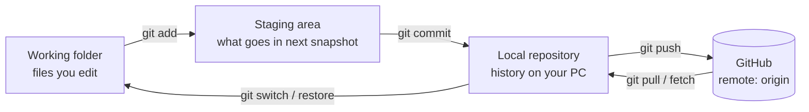
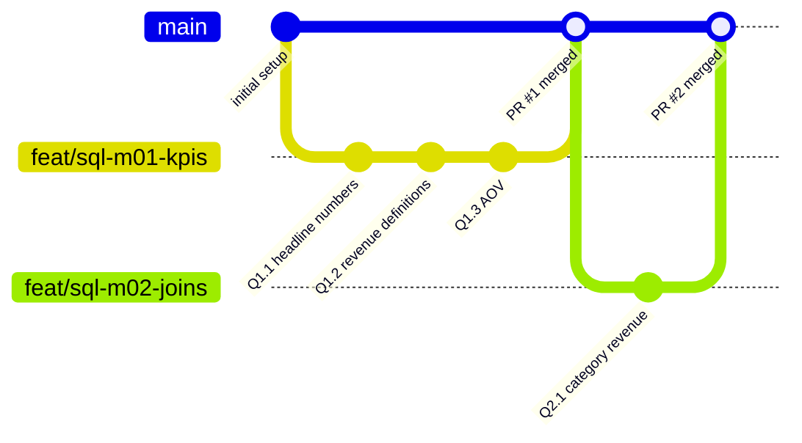

# 🌿 Git & GitHub — From Zero to Industry Workflow

> Goal: by the end you can run your Olist project the way a professional data team runs theirs — branches, pull requests, clean history, no secrets leaked, and a portfolio repo that impresses recruiters.
> Written for **Windows + VS Code + DBeaver**. Mac/Linux differences are noted.

---

## 1. The mental model (read this twice)

**Git** = a program on your computer that records snapshots (commits) of your project so you can go back, compare, and work in parallel.
**GitHub** = a website that hosts a copy of your Git repository, plus collaboration tools (pull requests, issues, project boards).



| Word | Meaning |
|---|---|
| **Repository (repo)** | A project folder tracked by Git (has a hidden `.git` folder) |
| **Commit** | A saved snapshot + message + author + time. Your "save point" |
| **Branch** | A separate line of work. `main` is the stable one |
| **Remote / origin** | The GitHub copy of your repo |
| **Clone** | Download a repo from GitHub |
| **Pull Request (PR)** | A request to merge your branch into `main`, with review |
| **Merge** | Combine one branch's work into another |
| **HEAD** | "Where you are now" |

---

## 2. One-time setup (30 minutes)

### 2.1 Install & verify
1. Download **Git for Windows**: <https://git-scm.com/download/win> (accept defaults; choose **VS Code** as default editor if offered).
2. Create a free account at <https://github.com> (use a professional username — recruiters see it).
3. Open **Git Bash** (or VS Code terminal) and check:
```bash
git --version
```

### 2.2 Tell Git who you are
```bash
git config --global user.name  "Your Name"
git config --global user.email "your-github-email@example.com"
git config --global init.defaultBranch main
git config --global core.autocrlf true        # Windows. On Mac/Linux use: input
git config --global core.editor "code --wait" # VS Code as editor
git config --global pull.rebase false         # simple, predictable pulls
git config --global --list
```
> 💡 Privacy: GitHub → Settings → Emails → "Keep my email private" and use the `…@users.noreply.github.com` address shown there.

### 2.3 Connect to GitHub securely (SSH key — recommended)
```bash
ssh-keygen -t ed25519 -C "your-github-email@example.com"   # press Enter for defaults
cat ~/.ssh/id_ed25519.pub                                    # copy the output
```
GitHub → Settings → **SSH and GPG keys** → New SSH key → paste. Test:
```bash
ssh -T git@github.com     # "Hi <username>! You've successfully authenticated"
```
<details><summary>Prefer HTTPS? (alternative)</summary>

Install **GitHub CLI** (`winget install GitHub.cli`), run `gh auth login`, choose HTTPS, follow the browser flow. Passwords no longer work for Git operations — you need a token or this login.
</details>

---

## 3. Your first repository (Lab 1)

**Option A — start on GitHub (easiest):**
1. GitHub → **New repository** → name `olist-analytics` → Public → ✅ Add README → ❌ leave `.gitignore` empty (our starter pack brings its own) → Create.
2. Clone it:
```bash
cd ~/Documents
git clone git@github.com:<your-username>/olist-analytics.git
cd olist-analytics
code .
```
3. Copy the files from this starter pack into the folder (overwrite README and `.gitignore`).

**Option B — start locally, push later:**
```bash
mkdir olist-analytics && cd olist-analytics
git init
git remote add origin git@github.com:<your-username>/olist-analytics.git
# (create the empty repo on GitHub first)
```

**First commit & push:**
```bash
git status                       # what changed?
git add .                        # stage everything (review .gitignore first!)
git commit -m "chore: initial project structure and SQL setup scripts"
git push -u origin main          # -u links local main to origin/main
```

---

## 4. The daily loop (learn these 6 commands first)

```bash
git status                  # always start here
git add <file>              # or: git add .   (stage changes)
git commit -m "message"     # snapshot
git push                    # upload
git pull                    # download others'/your other-machine changes
git log --oneline --graph   # see history
```
Useful extras: `git diff` (unstaged changes), `git diff --staged`, `git show <commit>`.

---

## 5. 🏭 The industry workflow: GitHub Flow

Never work directly on `main`. `main` is always clean and presentable. Every piece of work follows this cycle:



### Step-by-step for each module

```bash
# 1. Start from an up-to-date main
git switch main
git pull

# 2. Create a branch for the work
git switch -c feat/sql-m01-kpis

# 3. Work. Commit small and often (one problem = one commit)
git add sql/solutions/m01_kpis/Q1.1_headline_numbers.sql
git commit -m "feat(sql): add Q1.1 headline KPIs"

# 4. Push the branch
git push -u origin feat/sql-m01-kpis

# 5. On GitHub: click "Compare & pull request" -> fill the template -> Create PR
#    Review your own diff line by line (this is a real habit seniors have).
# 6. "Squash and merge" (or Merge) -> Delete branch on GitHub
# 7. Back locally
git switch main
git pull
git branch -d feat/sql-m01-kpis
```

### Branch naming
| Prefix | Use | Example |
|---|---|---|
| `feat/` | new analysis/work | `feat/sql-m05-window-functions` |
| `fix/` | correcting a mistake | `fix/q2-4-double-counting` |
| `docs/` | documentation | `docs/update-readme-insights` |
| `chore/` | setup/cleanup | `chore/add-gitignore` |
| `exp/` | experiments | `exp/churn-model-xgboost` |

### Commit message convention (Conventional Commits)
Format: `type(scope): short imperative summary` (≤ 72 chars)

| Type | When | Example |
|---|---|---|
| `feat` | new analysis / query / dashboard page | `feat(sql): add seller scorecard Q8.1` |
| `fix` | bug / wrong logic | `fix(sql): remove fan-out in revenue join` |
| `docs` | README, comments, insights | `docs: add insight summary for Q3.2` |
| `refactor` | same result, cleaner code | `refactor(sql): convert nested subqueries to CTEs` |
| `data` | data prep/model tables | `data: create v_order_master view` |
| `chore` | tooling, structure | `chore: add gitignore for csv and env files` |
| `perf` | speed | `perf(sql): add index on order_items(seller_id)` |

> ❌ Bad: `update`, `final`, `final_v2`, `asdf`  ✅ Good: `fix(sql): exclude canceled orders from AOV`

### Why this matters in interviews
You can truthfully say: *"I managed my analytics project with feature branches, PRs, conventional commits and an issue-tracked backlog."* That is exactly how data teams (dbt, analytics engineering) work.

---

## 6. 🚫 .gitignore & what NOT to commit

| Never commit | Because | What to do instead |
|---|---|---|
| **Passwords, API keys, DB credentials** | Bots scrape GitHub within minutes | Never type them into `.sql` files. DBeaver stores connection passwords in its own settings. If a config file is ever needed, use an ignored `.env` |
| **Raw CSV data (~120 MB total)** | Repo bloat; license; GitHub blocks files >100 MB | Document download link in `data/README.md` |
| DBeaver connection configs (`.dbeaver/`, `data-sources*.json`) | Contain credentials | ignored |

The starter pack's `.gitignore` already covers this. **Check before every first push:** `git status` should show no CSV, no `.env`.

> 🔥 If you accidentally commit a secret: **change the password immediately**. Deleting the file in a new commit does not remove it from history. Rotating the credential is the real fix.

---

## 7. Undo toolkit (the part that removes fear)

| Situation | Command |
|---|---|
| Discard unsaved edits to a file | `git restore <file>` |
| Unstage a file (keep edits) | `git restore --staged <file>` |
| Fix last commit message / add forgotten file (not pushed yet) | `git add <file>` then `git commit --amend` |
| Undo last commit but keep work | `git reset --soft HEAD~1` |
| Undo a **pushed** commit safely | `git revert <commit-hash>` (creates a new "undo" commit) |
| Park work temporarily | `git stash` … later `git stash pop` |
| "I broke everything" safety net | `git reflog` (history of where HEAD has been) |

**Rule of thumb:** local & unpushed → `reset` is fine. Already pushed/shared → use `revert`. Never force-push to `main`.

---

## 8. Merge conflicts (they are normal)

A conflict happens when two branches changed the same lines. Git marks it:
```
<<<<<<< HEAD
SELECT COUNT(*) FROM orders;
=======
SELECT COUNT(DISTINCT order_id) FROM orders;
>>>>>>> feat/sql-m01-kpis
```
Fix: edit the file to the version you want (delete the marker lines), then
```bash
git add <file>
git commit
```
VS Code shows buttons: *Accept Current / Incoming / Both*. Practice on purpose in Lab 4.

---

## 9. GitHub features that make you look professional

| Feature | How to use it for this project |
|---|---|
| **Issues** | Create one issue per module (or per hard problem). Clickable checkboxes track sub-tasks. Template in `.github/ISSUE_TEMPLATE/` |
| **Labels** | `chapter:0` … `chapter:12`, `difficulty:hard`, `bug` |
| **Projects (board)** | New project → Board → columns *Backlog / In progress / Review / Done* → add issues |
| **Pull Request template** | Auto-fills your PR with a checklist (in `.github/PULL_REQUEST_TEMPLATE.md`) |
| **Closing keywords** | Put `Closes #3` in a PR description → issue closes automatically on merge |
| **Releases/Tags** | `git tag -a v0.1-sql -m "SQL module complete"` + `git push --tags` |
| **Branch protection** | Settings → Branches → require a pull request before merging to `main` (enforces your own discipline) |
| **Profile README & pinned repos** | Pin `olist-analytics` on your profile; recruiters look there |
| **Repo "About" box** | Add description + topics: `sql`, `postgresql`, `data-analysis`, `power-bi`, `olist` |

---

## 10. How Git fits with your tools

- **VS Code:** Source Control tab (left sidebar) shows changes, lets you stage/commit/push. Install the *GitLens* extension (optional). Learn the terminal commands first so you understand what the buttons do.
- **DBeaver:** Save scripts as `.sql` files **inside the repo folder** (File → Open File / set workspace). Commit the `.sql` files. Never commit connection settings.
- **Results & charts:** save screenshots of important results or ER diagrams into `reports/figures/` and reference them in your README.

---

## 11. 🧪 Practice labs

| Lab | Task | You learn |
|---|---|---|
| 1 | Create repo, add README, first commit, push | add/commit/push |
| 2 | Branch `feat/sql-m00-profiling`, add 3 commits, open a PR, merge, delete branch | GitHub Flow |
| 3 | Edit a file, run `git restore`; make a bad commit, `git reset --soft HEAD~1`; make a pushed bad commit, `git revert` | undo toolkit |
| 4 | Create a **conflict on purpose**: edit the same line on `main` and on a branch, merge, resolve | conflict resolution |
| 5 | Add a fake `.env` with a fake password, see it in `git status`, add to `.gitignore`, verify it disappears | secret hygiene |
| 6 | Delete your local folder, `git clone` again, rebuild the DB using only the README | reproducibility |
| 7 | Create an Issue for Module 1, reference it in a PR with `Closes #1`, watch it auto-close | issue-PR linking |

---

## 12. 🎤 Interview questions (with short answers)

<details><summary><b>Git vs GitHub?</b></summary>Git is the version-control tool; GitHub is a hosting and collaboration platform for Git repos.</details>
<details><summary><b>What is the staging area?</b></summary>A buffer where you choose exactly which changes go into the next commit.</details>
<details><summary><b>merge vs rebase?</b></summary>Merge joins histories with a merge commit (preserves true history). Rebase replays your commits on top of another branch for a linear history — don't rebase shared/pushed branches.</details>
<details><summary><b>reset vs revert?</b></summary>Reset moves the branch pointer (rewrites history; local use). Revert adds a new commit that undoes a change (safe for shared history).</details>
<details><summary><b>fork vs clone?</b></summary>Clone copies a repo to your machine. Fork copies someone else's repo into your GitHub account so you can propose changes via PR.</details>
<details><summary><b>You committed a password. What now?</b></summary>Rotate/revoke the credential immediately; then remove from history (e.g. git filter-repo) if needed; add to .gitignore; use env variables/secret managers.</details>
<details><summary><b>Why not commit raw data?</b></summary>Size, licensing, reproducibility via scripts/docs is better; use Git LFS or a data store for large assets.</details>
<details><summary><b>What's a good commit?</b></summary>Small, single purpose, tested, with a message explaining what and why.</details>

---

## 13. 📋 Cheat sheet

```bash
# Setup
git config --global user.name "Name"; git config --global user.email "mail"
# Start
git clone <url>        git init
# Inspect
git status   git log --oneline --graph --all   git diff   git diff --staged
# Save
git add .   git commit -m "type(scope): msg"   git push   git pull
# Branch
git switch -c <new>   git switch <existing>   git branch   git branch -d <name>
# Undo
git restore <f>   git restore --staged <f>   git reset --soft HEAD~1   git revert <hash>   git stash / git stash pop   git reflog
# Tags
git tag -a v1.0 -m "msg"   git push --tags
```

**Your habit loop:** `git switch main && git pull` → `git switch -c feat/...` → work + small commits → `git push` → PR → merge → delete branch.
