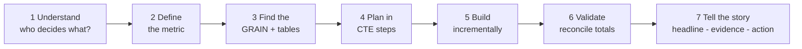

# 🕵️ Olist Case Files — SQL Problem Bank (Story Edition)

> **122 cases · 13 chapters · one story.** You are the new Junior Data Analyst at a fast-growing Brazilian marketplace. Over 13 chapters you go from auditing a messy database to presenting a recommendation to the board.
> Database: **PostgreSQL 18** · Schema: `olist` · Tool: **DBeaver**

---

## 🎬 The story so far

**Mid-October 2018.** Olist has grown fast for two years, but 2018 *feels* flatter. Complaints about late deliveries are rising, the CFO and the product team quote different revenue numbers, and the CEO faces the board in **four weeks**. The company has no senior analyst — it just hired **you**.

Your manager hands you a laptop and says: *"The warehouse is loaded. Nobody has checked it. Find out what is true, then tell us what to do about it."*

> ⚠️ The company, the people and every message below are **fictional** (invented to give each task a real-world feel). The **data is real** (anonymised Olist orders, 2016–2018).

### 👥 The cast

| Person | Role | What they care about | How they talk |
|---|---|---|---|
| **Marina Costa** | Head of Data (your manager) | Correctness, documentation, clear thinking | Calm, Socratic. *"How do you know that's right?"* |
| **Helena Duarte** | CEO | Growth, the board, the big picture | Short, urgent. Wants a **headline first** |
| **Bia Santos** | CFO | Reconciled numbers, risk | Precise, sceptical |
| **Carlos Mendes** | COO | Delivery speed, operations | Practical, frustrated by delays |
| **Tiago Ribeiro** | CMO | Customers, campaigns, acquisition cost | Energetic, loves a good story |
| **Juliana Prado** | Head of Customer Experience | Reviews, complaints, satisfaction | Empathetic, customer-first |
| **Lucas Ferraz** | Head of Seller Success | Seller quality, onboarding | Diplomatic, needs evidence to act |
| **Paulo Nunes** | Category & Merchandising Manager | What sells, pricing | Hands-on, intuition-driven |
| **Sofia Lima** | Payments Product Manager | Payment methods, installments | Analytical, product-minded |
| **Diego Rocha** | Data Engineer / BI developer | Clean models, fast queries | Technical, dry humour |

---

## 📖 How to work a case

### The Case Loop (use it every time)

### The Story Format (every case ends with this — it is 50% of the grade)

> **Headline** — one sentence a CEO could repeat in a lift.
> **Evidence** — 2–3 numbers from your query (with the definition used).
> **So what / Action** — what should we do, and what would you check next?

*Worked example (numbers are placeholders):*
> **Headline:** Growth stalled because customers don't come back, not because we stopped acquiring them.
> **Evidence:** Only **x%** of customers placed a second order (Q7.1); new-customer orders grew **y%** YoY while returning-customer orders were flat (Q7.2).
> **Action:** Pilot a day-N win-back campaign (timing from Q7.4) and track repeat rate monthly; investigate whether late first deliveries suppress repeat purchase (Q7.8).

### Self-scoring rubric (be honest — an interviewer will be)

| Criterion | 0 | 1 | 2 |
|---|---|---|---|
| **Correct** | wrong / not validated | mostly right | right and reconciled |
| **Definitions & grain** | unstated | partly stated | explicit in the file header |
| **Readable SQL** | one 80-line blob | some structure | CTEs, naming, comments |
| **Validation** | none | one check | two independent checks |
| **Story** | numbers only | numbers + opinion | headline → evidence → action |

**8–10 = interview-ready · 5–7 = redo the weakest row · <5 = revisit after the hint.**

### Ground rules
- ⏱ Try **20 minutes** before opening a 💡 hint. Struggle is where learning happens.
- 🤖 Use AI **after** you have a working answer: ask it to critique, find edge cases, or optimise.
- 🌿 One chapter = one Git branch = one Pull Request (`docs/guides/GIT_GITHUB_GUIDE.md`).
- 📝 After each chapter write a **chapter note** (5–8 lines, story format) in `reports/chapter_notes/`.
- 📓 Add a dated entry to `reports/learning_log.md` (what was hard, what you learned).
- 🏆 Cases that feed a portfolio project are listed in `docs/PROJECTS.md` — give those extra polish.
- 🗓 All queries start with `SET search_path TO olist, public;`
- 🆕 Items marked **PG18** use a PostgreSQL 18 feature; everything else runs on PostgreSQL 14+.

**Difficulty:** 🟢 Foundation · 🟡 Intermediate · 🔴 Advanced / interview-level · `⏱` = rough time

---

## 🗺️ Chapter map

| # | Chapter | Story beat | Core concepts | Cases |
|---|---|---|---|---:|
| 0 | [Day One: Trust Nothing](#module-0-day-one-trust-nothing) | You audit the warehouse | grain, keys, NULLs, orphans, data quality | 9 |
| 1 | [Board Meeting Friday](#module-1-board-meeting-friday) | The CEO needs her KPI pack | SELECT, WHERE, GROUP BY, CASE, dates | 12 |
| 2 | [The Case of the Inflated Revenue](#module-2-the-case-of-the-inflated-revenue) | Finance vs the dashboard | JOINs, fan-out, pre-aggregation | 10 |
| 3 | [The Monday Ops Review](#module-3-the-monday-ops-review) | Deliveries are late. How late? | conditional aggregation, FILTER, percentiles | 11 |
| 4 | [Code Review with Marina](#module-4-code-review-with-marina) | "It works, but nobody can read it" | subqueries, EXISTS, CTE design | 8 |
| 5 | [The Board's Favourite Charts](#module-5-the-boards-favourite-charts) | Trends, rankings, Pareto | window functions | 12 |
| 6 | [Black Friday & Messy Data](#module-6-black-friday--messy-data) | One crazy day, one dirty column | dates, text, NULLs | 8 |
| 7 | [Where Did the Customers Go?](#module-7-where-did-the-customers-go) | The retention mystery | cohorts, retention, RFM, LTV | 10 |
| 8 | [The Seller Quality Crisis](#module-8-the-seller-quality-crisis) | Who is hurting the brand? | scorecards, SLAs, lanes, risk | 10 |
| 9 | [Merchandising Strategy](#module-9-merchandising-strategy) | What to grow, what to cut | Pareto, basket analysis, pricing | 9 |
| 10 | [The Voice of the Customer](#module-10-the-voice-of-the-customer) | Reading what customers say | reviews, NPS, root cause | 6 |
| 11 | [Building the Platform](#module-11-building-the-platform) | Diego needs a real data model | star schema, views, EXPLAIN, functions | 9 |
| 12 | [Board Meeting: The Final Cases](#module-12-board-meeting-the-final-cases) | Recommendations that move money | end-to-end, open-ended | 8 |

---

## Module 0: Day One: Trust Nothing

*Monday, 08:45. Marina slides a coffee across the desk.*
*"Diego loaded the CSVs on Friday. The log says **success**. I've learnt not to believe logs. In this team **no number leaves the building until the data has been audited** — your first week is that audit."*

**Chapter goal:** know what one row means in every table, and prove which parts of the data can be trusted. **Chapter note:** `reports/chapter_notes/m00.md`.

### Q0.1 🟢 The Roll Call `⏱ 10 min`
> 💬 **Diego Rocha · Data Engineer** — *"Loaded nine CSVs Friday night. Log says success, but I've been burnt before. Can you confirm every table has data and nothing is suspiciously tiny?"*

**🎯 Mission:** Count the rows of all nine tables in a single result set.
**📦 Deliver:** `table_name, row_count`.
**🧠 Skills:** `UNION ALL`, `COUNT(*)`

💡 Hint
Stack nine SELECTs with a literal table-name column. Compare with the rough expectations in <code>00_inspect_loaded_tables.sql</code> — a big gap means a broken load.

### Q0.2 🟢 The Missing Months `⏱ 20 min`
> 💬 **Marina Costa · Head of Data** — *"Plot orders per month. September–October 2018 look suspiciously thin, and late 2016 is nearly empty. Is that a business collapse, a ramp-up, or a pipeline cut-off? I need to know which months we can trust — and write down the analysis window we'll use for **every** report."*

**🎯 Mission:** Find the first and last purchase timestamps, count orders per month, and flag months with fewer than 1,000 orders as `ramp-up / incomplete`. Decide and document the analysis window.
**📦 Deliver:** monthly table with a `reliability` flag + a one-line window decision.
**🧠 Skills:** `MIN/MAX`, `date_trunc`, `CASE`

💡 Hint
A drop caused by missing data is not a business decline. Your window decision will be reused in Q1.4, Q5.10 and C1.

### Q0.3 🟢 Delivered… But Not Really `⏱ 25 min`
> 💬 **Carlos Mendes · COO** — *"My ops screen says 'delivered' for some orders that have no delivery date, and some 'shipped' orders already have one. If statuses and timestamps disagree, my on-time KPI is fiction."*

**🎯 Mission:** Count orders per `order_status`. For each status, count the NULLs in each lifecycle timestamp. Report every status/timestamp combination that looks illogical.
**📦 Deliver:** a status × NULL-count matrix + a list of illogical combinations.
**🧠 Skills:** `COUNT(*) FILTER (WHERE col IS NULL)`

💡 Hint
<code>COUNT(col)</code> ignores NULLs, <code>COUNT(*)</code> doesn't — the difference is your NULL count.

### Q0.4 🟡 The 0% Repeat-Rate Disaster `⏱ 30 min`
> 💬 **Diego Rocha** — *"Last quarter an intern reported a 0% repeat-purchase rate and the CEO nearly cancelled the retention programme. I want to know exactly why that happened — which columns are truly unique, and what **one row** means in every table."*

**🎯 Mission:** Decide the grain of each table. Write uniqueness checks for `orders.order_id`, `customers.customer_id`, `customers.customer_unique_id`, `order_reviews.review_id` and `(order_id, order_item_id)`. Explain each result in one sentence.
**📦 Deliver:** a "grain table" (table → what a row is → key) + the duplicates you found.
**🧠 Skills:** `GROUP BY … HAVING COUNT(*) > 1`, `COUNT(DISTINCT)`

💡 Hint
Compare <code>COUNT(*)</code> with <code>COUNT(DISTINCT col)</code>. Wrong grain assumptions cause almost every inflated-number bug. <em>🔗 This case sets up Q7.1.</em>

### Q0.5 🟡 Orphan Hunt `⏱ 30 min`
> 💬 **Diego Rocha** — *"I'm about to add foreign keys. Tell me which relationships will blow up — I want every orphan, with counts."*

**🎯 Mission:** Find (a) orders with no items, (b) items whose order doesn't exist, (c) orders with no payment, (d) items whose product isn't in `products`, (e) orders with no review. Give counts and % of orders.
**📦 Deliver:** one summary table, one row per check.
**🧠 Skills:** `LEFT JOIN … WHERE x IS NULL`, `NOT EXISTS`

💡 Hint
Anti-join: keep the left table, join the right, filter where the right key IS NULL. Look at the <code>order_status</code> of orphan orders — the pattern tells the story.

### Q0.6 🟡 The Time Travellers `⏱ 25 min`
> 💬 **Carlos Mendes** — *"A customer apparently received the parcel before the seller gave it to the carrier. Either we have time travellers or our timestamps are broken. How bad is it?"*

**🎯 Mission:** Count orders where approval < purchase, carrier pickup < approval, customer delivery < carrier pickup, and customer delivery < purchase. Show each count and % of orders. Decide whether to exclude these rows and justify it.
**📦 Deliver:** 4-row summary + a written decision.
**🧠 Skills:** conditional aggregation, timestamp comparison

💡 Hint
One SELECT with several <code>COUNT(*) FILTER (WHERE …)</code>. Excluding data is a decision — document it.

### Q0.7 🟡 The Mystery Category `⏱ 20 min`
> 💬 **Paulo Nunes · Category Manager** — *"My category dashboard has a blank bar bigger than 'toys'. Who's the mystery category and how much revenue is hiding in it?"*

**🎯 Mission:** Find products with NULL category and categories missing from the translation table, and the revenue attached to each gap. Propose a fallback label.
**📦 Deliver:** gap type, products affected, revenue, % of total revenue.
**🧠 Skills:** `LEFT JOIN`, `COALESCE`, `SUM`

💡 Hint
Two different problems: NULL category vs a non-NULL category that has no English translation.

### Q0.8 🔴 The Map That Doubled Our Orders `⏱ 40 min`
> 💬 **Diego Rocha** — *"I joined geolocation to customers to draw a map and my customer count exploded. Why? Fix it so I can ship the map."*

**🎯 Mission:** Show rows-per-zip-prefix in `geolocation`, prove a direct join inflates customer rows, then build a **deduplicated** lookup (one row per zip prefix, average lat/lng) and prove the join is now safe.
**📦 Deliver:** before/after counts + the safe lookup as a CTE or view.
**🧠 Skills:** fan-out, CTE, `AVG`, `GROUP BY`

💡 Hint
Compare <code>COUNT(*)</code> of customers before and after each join. Rule of the team: <em>never join to a table until you know its grain.</em>

### Q0.9 🔴 "Is the Data Healthy Today?" `⏱ 60 min`
> 💬 **Marina Costa** — *"Last task of Week 1. Package your whole audit into one view anyone in the company can query: is our data healthy today? This will be your first deliverable that other people depend on."*

**🎯 Mission:** Build `olist.v_dq_scorecard` with `check_name, table_name, failing_rows, total_rows, pct_failing, severity` containing **at least 10 checks** from Q0.3–Q0.8.
**📦 Deliver:** the view + a 5-line chapter note.
**🧠 Skills:** `UNION ALL`, CTE, `CREATE VIEW`

💡 Hint
Write each check as a SELECT returning the same six columns, then stack them. Severity HIGH = changes revenue/KPIs; LOW = cosmetic.

---

## Module 1: Board Meeting Friday

*Week 2. Helena, the CEO, walks to your desk — unusual enough that Marina looks up.*
*"Friday's board meeting. Investors think our 2018 growth has stalled. I need a KPI pack I can defend line by line. Marina says you're careful with definitions. **Prove it.**"*

**Chapter goal:** compute core business KPIs with precise definitions. **Chapter note:** `reports/chapter_notes/m01.md`.

### Q1.1 🟢 Five Numbers on One Slide `⏱ 20 min`
> 💬 **Helena Duarte · CEO** — *"One slide, one row: orders, delivered orders, customers, active sellers, products sold, and GMV. Don't make me ask what any of them means."*

**🎯 Mission:** Compute the six numbers in one row. "Customers" means **people**, not accounts.
**📦 Deliver:** one row, six columns, definitions in comments.
**🧠 Skills:** `COUNT(DISTINCT)`, joins, aggregation

💡 Hint
Customers = <code>customer_unique_id</code>, not <code>customer_id</code> (Q0.4!). GMV = sum of item prices — state your choice.

### Q1.2 🟢 Three Versions of "Revenue" `⏱ 30 min`
> 💬 **Bia Santos · CFO** — *"Sales says R$X. My ledger says R$Y. Both numbers come from 'the database'. Either one of us is wrong or both of us are right about different things. Which?"*

**🎯 Mission:** For delivered orders compute (1) `SUM(price)`, (2) `SUM(price + freight_value)`, (3) `SUM(payment_value)`. Explain every gap in comments.
**📦 Deliver:** three numbers side by side + 3 lines explaining the differences.
**🧠 Skills:** aggregation, pre-aggregation

💡 Hint
Aggregate items and payments in <em>separate</em> subqueries — never join both and then sum. <em>🔗 This is a warm-up for Chapter 2.</em>

### Q1.3 🟢 The AOV Argument `⏱ 25 min`
> 💬 **Tiago Ribeiro · CMO** — *"My campaign deck quotes an average order value. Bia says it's wrong. I don't know who's right — can you settle it?"*

**🎯 Mission:** Compute AOV (price + freight per order) for delivered orders. Then compute the *wrong* answer (`AVG(price)` over item rows) and explain why they differ.
**📦 Deliver:** correct AOV, wrong AOV, and why.
**🧠 Skills:** two-level aggregation

💡 Hint
Sum to the order level first (CTE), then average those totals.

### Q1.4 🟢 The Growth Chart `⏱ 25 min`
> 💬 **Helena Duarte** — *"This is the chart the board will stare at: orders and revenue, month by month. Make sure I'm not showing them a fake decline."*

**🎯 Mission:** Per month: delivered orders, item revenue, freight, revenue per order — respecting your window from Q0.2. *(A fully documented example solution is in `sql/solutions/m01_kpis/` to show the documentation standard; study the structure, don't copy the logic into other cases.)*
**📦 Deliver:** monthly table ready for a line chart.
**🧠 Skills:** `date_trunc`, `GROUP BY`, `COUNT(DISTINCT)`

💡 Hint
Watch incomplete first/last months — you decided how to treat them in Q0.2.

### Q1.5 🟢 Where Do Our Customers Live? `⏱ 20 min`
> 💬 **Tiago Ribeiro** — *"I'm splitting the campaign budget by state. Which states actually hold our customers — and how concentrated are we?"*

**🎯 Mission:** Top 10 states by unique customers with % share and cumulative share.
**📦 Deliver:** `state, customers, pct, cum_pct`.
**🧠 Skills:** `GROUP BY`, window `SUM() OVER ()`

💡 Hint
<code>cnt * 100.0 / SUM(cnt) OVER ()</code> — the <code>100.0</code> avoids integer division.

### Q1.6 🟢 How Do Brazilians Pay? `⏱ 25 min`
> 💬 **Sofia Lima · Payments PM** — *"I'm planning the payments roadmap. Boleto? Credit card? Vouchers? Show me the mix — and remember an order can be paid in several ways."*

**🎯 Mission:** Per `payment_type`: number of orders, total payment value, % of value.
**📦 Deliver:** payment mix table.
**🧠 Skills:** `COUNT(DISTINCT)`, share-of-total

💡 Hint
Orders and payment rows are different grains — count distinct orders.

### Q1.7 🟢 The Installment Culture `⏱ 20 min`
> 💬 **Sofia Lima** — *"Everyone says Brazilians love installments. Do they? And which payment type even allows them?"*

**🎯 Mission:** Average and max installments by payment type; % of credit-card orders paid in 2+ installments.
**📦 Deliver:** one table + one sentence verdict.
**🧠 Skills:** `AVG`, `FILTER`, ratios

💡 Hint
Verify "only credit cards use installments" with your own data before asserting it.

### Q1.8 🟡 Small Orders, Big Money? `⏱ 30 min`
> 💬 **Paulo Nunes** — *"I feel like lots of tiny orders keep us busy but big orders make the money. Is my gut right?"*

**🎯 Mission:** Bucket order value into `<50, 50–100, 100–200, 200–500, 500+`. Per bucket: orders, % of orders, revenue, % of revenue.
**📦 Deliver:** bucket table + verdict on Paulo's gut.
**🧠 Skills:** `CASE`, CTE, share-of-total

💡 Hint
Compute order totals in a CTE, then bucket. Compare % of orders with % of revenue.

### Q1.9 🟡 When Do Brazilians Shop? `⏱ 30 min`
> 💬 **Tiago Ribeiro** — *"When should I schedule my email blasts? Which hours and days are gold?"*

**🎯 Mission:** Orders by day of week and by hour; top 3 hours and the weakest day.
**📦 Deliver:** two small tables + a scheduling recommendation.
**🧠 Skills:** `EXTRACT(ISODOW/HOUR)`

💡 Hint
<code>DOW</code> starts Sunday=0, <code>ISODOW</code> starts Monday=1. Pick one and label it clearly.

### Q1.10 🟢 Is Shipping Eating Our Margin? `⏱ 25 min`
> 💬 **Carlos Mendes** — *"Customers complain about freight. Is shipping a big slice of what they pay — and is it getting worse?"*

**🎯 Mission:** Freight as % of item price, overall and by month. Trend direction?
**📦 Deliver:** monthly ratio + verdict.
**🧠 Skills:** ratios, `date_trunc`

💡 Hint
Ratio of sums ≠ average of ratios. Choose the right one and explain why.

### Q1.11 🟡 One Thing or Many? `⏱ 25 min`
> 💬 **Paulo Nunes** — *"Do customers buy one item per order or fill a basket? It changes how I bundle."*

**🎯 Mission:** Distribution of items per order (1, 2, 3, 4+) with % of orders; average items per order.
**📦 Deliver:** distribution table.
**🧠 Skills:** two-level aggregation, `CASE`

💡 Hint
Items per order = <code>COUNT(*)</code> of item rows grouped by order.

### Q1.12 🟢 How Happy Are We? `⏱ 25 min`
> 💬 **Juliana Prado · Head of CX** — *"Give me the satisfaction picture: how many 1-stars, how many 5-stars? And tell me how you handled the duplicate reviews — I heard there are some."*

**🎯 Mission:** % of reviews per score and the average score. Choose and document how you treat duplicates.
**📦 Deliver:** distribution table + the dedup decision.
**🧠 Skills:** `GROUP BY`, window share, data-quality judgement

💡 Hint
Your Q0.4 results tell you what's duplicated. <em>🔗 Sets up Q5.9.</em>

> 📝 **Chapter note:** write the "KPI pack summary" for Helena in story format (≤ 8 lines).

---

## Module 2: The Case of the Inflated Revenue

*Wednesday. The finance team's Slack channel lights up. Diego's new dashboard shows revenue **far higher** than the ledger. Bia sends one message to the whole analytics team: "**Someone explain this before the board.**"*

**Chapter goal:** master joins, spot fan-out, build trustworthy order-level data. **Chapter note:** `reports/chapter_notes/m02.md`.

### Q2.1 🟢 What Do We Sell? `⏱ 25 min`
> 💬 **Paulo Nunes** — *"Before we fight about revenue, tell me which categories earn it. English names please — my team doesn't read Portuguese."*

**🎯 Mission:** Top 15 categories by item revenue using English names; missing names become `'unknown'`.
**📦 Deliver:** category ranking; total must tie to Q1.1.
**🧠 Skills:** multi-table `JOIN`, `LEFT JOIN`, `COALESCE`

💡 Hint
items → products → translation. Use LEFT JOINs so gaps don't silently drop revenue.

### Q2.2 🟢 Revenue Map `⏱ 25 min`
> 💬 **Helena Duarte** — *"Which states bring in the money? I want it on a map by next week."*

**🎯 Mission:** Item revenue, orders and revenue per order by customer state (delivered orders).
**📦 Deliver:** state table.
**🧠 Skills:** `orders → customers → order_items`

💡 Hint
Three-table chain; <code>COUNT(DISTINCT order_id)</code> guards against fan-out.

### Q2.3 🟡 Meet the Heavyweights `⏱ 30 min`
> 💬 **Lucas Ferraz · Head of Seller Success** — *"I'm visiting our biggest sellers next week. Who are the top 20, where are they, and how big are they?"*

**🎯 Mission:** Top 20 sellers: id, city, state, orders, units, revenue, average price.
**📦 Deliver:** ranked seller table.
**🧠 Skills:** joins, aggregation, `ORDER BY … LIMIT`

💡 Hint
Add a second ORDER BY key so results are deterministic.

### Q2.4 🔴 The Smoking Gun `⏱ 60 min` ⭐ *must-do*
> 💬 **Bia Santos · CFO** — *"Diego's dashboard says revenue is ~20% above my ledger. He joined orders, items and payments and summed. I think he double-counted. **Prove it — and fix it.** Then list the orders where items+freight and payments don't agree by more than R$1."*

**🎯 Mission:** Join orders + items + payments naively and sum — show the over-count. Fix with pre-aggregated CTEs (one row per order per child table). Then find orders where `(price + freight)` and `payment_value` differ by more than R$1.
**📦 Deliver:** wrong total, right total, the explanation, and the mismatch list.
**🧠 Skills:** fan-out, pre-aggregation, CTE

💡 Hint
One order with 3 items and 2 payments becomes 6 rows. Aggregate each child table to <em>one row per order</em> before joining. This is the single most common analytics bug in the real world.

### Q2.5 🟡 Dead Stock `⏱ 25 min`
> 💬 **Paulo Nunes** — *"How many products are listed but have never sold a single unit? And sellers with no sales at all?"*

**🎯 Mission:** Products never appearing in `order_items` and sellers with zero items, as counts and % of each table.
**📦 Deliver:** two summary lines.
**🧠 Skills:** anti-join, `NOT EXISTS`

💡 Hint
<code>NOT EXISTS</code> is NULL-safe and fast; <code>NOT IN</code> can silently fail with NULLs (Q4.8).

### Q2.6 🟡 Crossing State Lines `⏱ 30 min`
> 💬 **Carlos Mendes** — *"How much of our volume ships across state lines? Long-haul is where my delays live."*

**🎯 Mission:** % of items where `seller_state = customer_state`, overall and per seller state.
**📦 Deliver:** overall % + table by seller state.
**🧠 Skills:** multi-join, conditional aggregation

💡 Hint
items → sellers and items → orders → customers; compare both state columns. <em>🔗 Feeds Q8.5.</em>

### Q2.7 🟡 Boleto Lovers `⏱ 35 min`
> 💬 **Sofia Lima** — *"Which categories lean on boleto, and which on credit cards? It affects approval delays and cancellation risk."*

**🎯 Mission:** For the top 10 categories, % of orders paid by credit_card, boleto, voucher, debit_card (one row per category).
**📦 Deliver:** category × payment-type matrix.
**🧠 Skills:** conditional aggregation (pivot)

💡 Hint
<code>COUNT(DISTINCT order_id) FILTER (WHERE payment_type='boleto')</code> per column.

### Q2.8 🔴 The Two-Seller Order `⏱ 45 min`
> 💬 **Carlos Mendes** — *"Some orders contain items from different sellers. I suspect those arrive slower — two parcels, two chances to be late. Am I right?"*

**🎯 Mission:** Find orders with items from >1 seller; their share of orders; average delivery days vs single-seller orders.
**📦 Deliver:** comparison table + verdict.
**🧠 Skills:** `HAVING COUNT(DISTINCT seller_id) > 1`, joins, date math

💡 Hint
Classify each order in a CTE, then join back to orders for dates.

### Q2.9 🔴 One Big Order Table `⏱ 75 min`
> 💬 **Diego Rocha** — *"After the revenue fiasco I want one trusted view: one row per order with everything attached. every report and every future query will start from it. Row count **must** equal the orders table."*

**🎯 Mission:** Create `olist.v_order_master` — one row per order: unique customer id, state, status, all timestamps, items count, sellers count, item revenue, freight, payment total, payment types (`string_agg`), average review score, delivery days, late flag.
**📦 Deliver:** the view + an assertion query proving row count = `orders`.
**🧠 Skills:** pre-aggregation, `string_agg`, grain control, `CREATE VIEW`

💡 Hint
One CTE per child table (items, payments, reviews), each grouped by order_id, then LEFT JOIN all onto orders. This becomes your single source of truth for the rest of the course.

### Q2.10 🟡 Specialists vs Generalists `⏱ 35 min`
> 💬 **Lucas Ferraz** — *"Do sellers who focus on a few categories perform better than the ones selling everything?"*

**🎯 Mission:** Number of distinct categories per seller; bucket sellers (1, 2–3, 4–9, 10+); compare revenue per seller and average review.
**📦 Deliver:** bucket comparison + verdict.
**🧠 Skills:** `COUNT(DISTINCT)`, bucketing, aggregate of aggregate

💡 Hint
Two stages: build a seller-level table first, then aggregate it by bucket.

> 📝 **Chapter note:** explain the inflated-revenue incident to Bia in story format — what happened, how big, how to prevent it.

---

## Module 3: The Monday Ops Review

*Monday, 09:00. Carlos opens the ops review with one slide: a screenshot of angry customer tweets.*
*"We keep saying 'delivery is fine'. I don't believe it. Give me real numbers: how late, where, when, and what it costs us in customer happiness."*

**Chapter goal:** operational KPIs with conditional aggregation, percentiles and careful definitions. **Chapter note:** `reports/chapter_notes/m03.md`.

### Q3.1 🟢 Are Cancellations Getting Worse? `⏱ 20 min`
> 💬 **Carlos Mendes** — *"Cancellations feel like they're creeping up. Month by month — fact or feeling?"*

**🎯 Mission:** Monthly orders, canceled orders, cancellation rate %.
**📦 Deliver:** monthly rate table.
**🧠 Skills:** `COUNT(*) FILTER`, ratio

💡 Hint
Denominator = all orders created that month.

### Q3.2 🟡 What Does "Late" Mean? `⏱ 35 min`
> 💬 **Carlos Mendes** — *"Everyone says 'late deliveries' but nobody agrees on the definition. Define it, measure it, and tell me which five states hurt the most."*

**🎯 Mission:** Define "late" precisely, then compute the late rate overall, by month and by customer state (delivered orders only). Top 5 worst states.
**📦 Deliver:** definition + three views of the rate.
**🧠 Skills:** timestamp comparison, `FILTER`, ratios

💡 Hint
Compare <code>delivered_customer_date &gt; estimated_delivery_date</code> — and decide whether comparing dates (not timestamps) is fairer. Document it.

### Q3.3 🟡 Average Is a Liar `⏱ 35 min`
> 💬 **Carlos Mendes** — *"Our average delivery time looks fine. But some customers wait forever. Show me the tail, not just the mean."*

**🎯 Mission:** Per customer state: average, median, p90 and p95 delivery days (purchase → delivered).
**📦 Deliver:** state table + 2 lines on why the median differs from the mean.
**🧠 Skills:** `percentile_cont(…) WITHIN GROUP (ORDER BY …)`

💡 Hint
Days = <code>EXTRACT(EPOCH FROM (end - start)) / 86400</code>.

### Q3.4 🟡 Where Does the Time Go? `⏱ 35 min`
> 💬 **Carlos Mendes** — *"Between click and doorbell there are three stages: approval, seller handoff, carrier transit. Which one eats the time?"*

**🎯 Mission:** Average days for purchase→approval, approval→carrier pickup, pickup→customer; show by month. Which stage dominates?
**📦 Deliver:** stage durations + bottleneck verdict.
**🧠 Skills:** interval math, aggregation

💡 Hint
Rows with NULL at either end of an interval are skipped by AVG — verify that's what you want.

### Q3.5 🟡 The Status Board `⏱ 25 min`
> 💬 **Carlos Mendes** — *"I want a one-glance weekly board: one row per month, one column per order status."*

**🎯 Mission:** One row per month with a count column for each status.
**📦 Deliver:** the pivoted table.
**🧠 Skills:** conditional aggregation

💡 Hint
One <code>COUNT(*) FILTER (WHERE order_status = '…')</code> per status.

### Q3.6 🟡 What Does a Late Parcel Cost Us? `⏱ 40 min`
> 💬 **Juliana Prado** — *"I need to convince Carlos that lateness hurts ratings. Put a number on it: how many stars do we lose for each day late?"*

**🎯 Mission:** Bucket delivered orders: `early, on-time, 1–3 days late, 4–7 late, 8+ late`. Per bucket: orders, average review, % of 1-star reviews.
**📦 Deliver:** bucket table + a one-line "price of lateness".
**🧠 Skills:** `CASE`, joins to reviews, aggregation

💡 Hint
Reduce reviews to one per order first (Q5.9 technique, or average per order). <em>🔗 Feeds Q10.2 and Q7.8.</em>

### Q3.7 🟡 The Disappointing Categories `⏱ 30 min`
> 💬 **Paulo Nunes** — *"Which categories upset customers the most? Ignore tiny ones — I only care about categories with real volume."*

**🎯 Mission:** Categories with ≥300 delivered orders ranked by lowest average review, with late rate beside it.
**📦 Deliver:** ranked list.
**🧠 Skills:** `HAVING`, multi-join

💡 Hint
<code>WHERE</code> filters rows before grouping; <code>HAVING</code> filters groups after. Which one handles "≥300 orders"?

### Q3.8 🟡 Split Payments `⏱ 30 min`
> 💬 **Sofia Lima** — *"How common is it to pay one order with two methods — and which combinations?"*

**🎯 Mission:** Share of orders with >1 payment row; the most common payment-type combinations (e.g. `credit_card+voucher`).
**📦 Deliver:** share + combination ranking.
**🧠 Skills:** `string_agg(DISTINCT … ORDER BY …)`

💡 Hint
Sort inside <code>string_agg</code> so equal combinations match.

### Q3.9 🟡 Voucher Effect `⏱ 30 min`
> 💬 **Tiago Ribeiro** — *"Do voucher users buy bigger baskets, or just cheaper ones?"*

**🎯 Mission:** Compare orders with vs without a voucher payment: count, average order value, average items.
**📦 Deliver:** comparison + verdict.
**🧠 Skills:** `EXISTS`/flag CTE, aggregation

💡 Hint
Flag each order first, then aggregate by flag.

### Q3.10 🔴 Are We Sandbagging the Promise? `⏱ 45 min`
> 💬 **Helena Duarte** — *"If our estimated delivery dates are too pessimistic we may be losing sales; too optimistic, and we create angry customers. Which is it?"*

**🎯 Mission:** For delivered orders compute `estimated − actual` days; histogram buckets; average by state. Where do we over-promise, where do we pad?
**📦 Deliver:** distribution + state table + recommendation.
**🧠 Skills:** interval math, bucketing

💡 Hint
Positive = delivered earlier than promised. A large positive average means estimates are very conservative.

### Q3.11 🟡 Does the Weekend Slow Us Down? `⏱ 30 min`
> 💬 **Carlos Mendes** — *"Do orders placed on weekends take longer to approve and ship?"*

**🎯 Mission:** Compare weekend vs weekday purchases on approval time, handoff time and total delivery time.
**📦 Deliver:** comparison table.
**🧠 Skills:** `EXTRACT(ISODOW)`, conditional grouping

💡 Hint
Create an <code>is_weekend</code> flag in a CTE, then compare.

> 📝 **Chapter note:** "Ops Review" summary for Carlos — three findings with numbers and one thing to fix first.

---

## Module 4: Code Review with Marina

*Thursday, 16:30. Marina pulls up one of your queries on the big screen. Seven nested subqueries. Nobody speaks.*
*"It's correct. I checked. But in six months **you** won't be able to read this, and I certainly can't. Today we learn to write SQL that a colleague can understand in 30 seconds."*

**Chapter goal:** structure multi-step logic with CTEs, subqueries and EXISTS. **Chapter note:** `reports/chapter_notes/m04.md`.

### Q4.1 🟢 Bigger Than Average `⏱ 20 min`
> 💬 **Paulo Nunes** — *"What share of our orders are larger than the average order? I want to know if a few big ones drag the average up."*

**🎯 Mission:** With a scalar subquery, return the count and share of delivered orders whose value exceeds the overall AOV.
**📦 Deliver:** count, share, and a sentence about skew.
**🧠 Skills:** scalar subquery, CTE for order totals

💡 Hint
The subquery returns one number; the outer query compares every order to it.

### Q4.2 🟡 Big Spenders in Their Own Backyard `⏱ 35 min`
> 💬 **Tiago Ribeiro** — *"I want local VIPs: customers who spend more than the typical customer in their own state. How many per state?"*

**🎯 Mission:** Unique customers whose total spend exceeds the average customer spend of their state; count per state. Write it as a correlated subquery **and** as CTE + join; compare readability.
**📦 Deliver:** state counts + your readability verdict.
**🧠 Skills:** correlated subquery vs CTE

💡 Hint
Customer spend → state average → compare. Which version would you rather maintain?

### Q4.3 🟡 Last Seen `⏱ 35 min`
> 💬 **Tiago Ribeiro** — *"For a win-back campaign I need each customer's most recent order. Fast."*

**🎯 Mission:** One row per unique customer with their latest order id and date, solved three ways: (a) correlated subquery, (b) `DISTINCT ON`, (c) window function.
**📦 Deliver:** three queries returning identical results + row-count proof.
**🧠 Skills:** equivalent approaches, `DISTINCT ON`

💡 Hint
<code>DISTINCT ON (customer_unique_id) … ORDER BY customer_unique_id, order_purchase_timestamp DESC</code> is PostgreSQL-specific and very handy.

### Q4.4 🟡 Overpriced? `⏱ 35 min`
> 💬 **Paulo Nunes** — *"Some sellers price far above their category. Customers notice. Who are they?"*

**🎯 Mission:** Sellers whose average price in a category is more than 2× that category's average (min 10 items).
**📦 Deliver:** seller, category, seller avg price, category avg price, ratio.
**🧠 Skills:** CTE, join to aggregate, `HAVING`

💡 Hint
One CTE for category averages, one for seller-category averages, then join on category.

### Q4.5 🟡 Unhappy But Loyal? `⏱ 40 min`
> 💬 **Juliana Prado** — *"Do customers who had a terrible first experience ever come back? Marketing says never. I'm not so sure."*

**🎯 Mission:** Customers whose **first** order scored ≤2 stars and who later placed another order. Count and share of all bad-first-order customers.
**📦 Deliver:** the two numbers + one-line reading.
**🧠 Skills:** `EXISTS`, ordering by time

💡 Hint
Find each customer's first order (Q4.3), join its review, then <code>EXISTS</code> a later order.

### Q4.6 🔴 The Order Funnel `⏱ 50 min`
> 💬 **Carlos Mendes** — *"Think of an order as a funnel: created, approved, handed to carrier, delivered. Where do we leak?"*

**🎯 Mission:** Funnel with counts and step-to-step conversion %, using one CTE per step.
**📦 Deliver:** funnel table with drop-off at each step.
**🧠 Skills:** multi-step CTE, ratios

💡 Hint
Count rows where each timestamp IS NOT NULL — timestamps tell the real story, statuses can lie (Q0.3).

### Q4.7 🔴 All Eggs, One Basket `⏱ 50 min`
> 💬 **Lucas Ferraz** — *"If our top seller in a category quit tomorrow, would the category collapse? Show me categories dangerously dependent on one seller."*

**🎯 Mission:** For categories with ≥R$50k revenue: top seller's share, number of sellers, risk flag when top share >50%.
**📦 Deliver:** risk table sorted by exposure.
**🧠 Skills:** CTE chain, window `MAX`/`RANK`, ratios

💡 Hint
Seller-category revenue → category total → share → keep the top row per category.

### Q4.8 🟡 The Query That Returned Nothing `⏱ 25 min`
> 💬 **Diego Rocha** — *"My anti-join using NOT IN returned zero rows. I know there should be some. What's going on?"*

**🎯 Mission:** Reproduce the problem with a list containing a NULL (e.g. product categories), explain why `NOT IN` returns nothing, then fix with `NOT EXISTS`.
**📦 Deliver:** broken query, fixed query, 3-line explanation.
**🧠 Skills:** three-valued logic (NULL semantics)

💡 Hint
<code>x NOT IN (1, NULL)</code> evaluates to UNKNOWN, never TRUE. A classic interview question.

> 📝 **Chapter note:** a before/after of one query you refactored, and what readability rule you'll follow from now on.

---

## Module 5: The Board's Favourite Charts

*Helena again: "The board loves three things — trends, rankings and the 80/20 rule. Give me all three, and don't hand me a table of 40 rows. **Give me the story in the chart.**"*

**Chapter goal:** window functions for rankings, running totals, growth and segmentation. **Chapter note:** `reports/chapter_notes/m05.md`.

### Q5.1 🟡 The Champions of Each State `⏱ 35 min`
> 💬 **Lucas Ferraz** — *"I want to recognise our top three sellers in every state at the partner summit. Who gets a trophy?"*

**🎯 Mission:** For each seller state, the top 3 sellers by revenue with rank and % of the state's revenue.
**📦 Deliver:** ≤ 3 rows per state.
**🧠 Skills:** `RANK() OVER (PARTITION BY … ORDER BY …)`, filtering a window result via CTE

💡 Hint
You can't filter on a window function in <code>WHERE</code> — wrap it in a CTE/subquery first.

### Q5.2 🟡 Cumulative Revenue `⏱ 30 min`
> 💬 **Bia Santos** — *"For the board: monthly revenue, cumulative revenue, and each month's contribution to the total."*

**🎯 Mission:** Monthly revenue + running total + % of total.
**📦 Deliver:** table ready for a combo chart.
**🧠 Skills:** `SUM() OVER (ORDER BY month)`, `SUM() OVER ()`

💡 Hint
With <code>ORDER BY</code> the default frame is start → current row; know why that matters.

### Q5.3 🟡 Month-over-Month `⏱ 30 min`
> 💬 **Helena Duarte** — *"How fast are we growing — month on month? One number per month."*

**🎯 Mission:** Monthly revenue, previous month, absolute change, % change.
**📦 Deliver:** growth table.
**🧠 Skills:** `LAG`, `NULLIF` for safe division

💡 Hint
<code>(cur - prev) * 100.0 / NULLIF(prev, 0)</code>.

### Q5.4 🟡 Cutting Through the Noise `⏱ 45 min`
> 💬 **Marina Costa** — *"Daily orders zigzag like a seismograph. Smooth them so the trend is visible — and be careful about days with zero orders."*

**🎯 Mission:** Daily orders with a 7-day moving average, using a complete calendar (days with 0 orders included).
**📦 Deliver:** daily series + MA7.
**🧠 Skills:** `generate_series`, `AVG() OVER (ROWS BETWEEN 6 PRECEDING AND CURRENT ROW)`

💡 Hint
LEFT JOIN daily counts onto a generated calendar so missing days become 0; otherwise "7 rows" ≠ 7 days.

### Q5.5 🔴 The 80/20 Rule `⏱ 45 min`
> 💬 **Helena Duarte** — *"If I could only protect a few categories, which ones carry 80% of revenue?"*

**🎯 Mission:** Rank categories by revenue with cumulative % share; label A (≤80%), B (80–95%), C (>95%). How many categories are A?
**📦 Deliver:** Pareto table + the count of A categories.
**🧠 Skills:** running `SUM`, `SUM() OVER ()`, `CASE`

💡 Hint
cum_pct = running sum ÷ grand total. Order by revenue DESC with a tie-breaker.

### Q5.6 🟡 Customer Deciles `⏱ 35 min`
> 💬 **Tiago Ribeiro** — *"Slice our customers into ten equal groups by spending. How much do the top 10% give us?"*

**🎯 Mission:** `NTILE(10)` customers by spend; per decile: customers, revenue, % of revenue.
**📦 Deliver:** decile table.
**🧠 Skills:** `NTILE(10)`

💡 Hint
Ties land arbitrarily across buckets — mention it in your assumptions.

### Q5.7 🟡 Time Between Orders `⏱ 35 min`
> 💬 **Tiago Ribeiro** — *"When someone does come back, how long after their previous order? I need this for campaign timing."*

**🎯 Mission:** For repeat customers, days between consecutive orders; average, median, and buckets.
**📦 Deliver:** distribution table.
**🧠 Skills:** `LAG(...) OVER (PARTITION BY customer_unique_id ORDER BY …)`

💡 Hint
The first order per customer has NULL lag — filter it out.

### Q5.8 🟡 The First Purchase `⏱ 40 min`
> 💬 **Tiago Ribeiro** — *"What do people buy first? And do first-category buyers differ in how often they return?"*

**🎯 Mission:** For each customer, the category of the first item of their first order; top 10 first-purchase categories and what % of those customers returned.
**📦 Deliver:** category table with return rate.
**🧠 Skills:** `ROW_NUMBER()`, `FIRST_VALUE`

💡 Hint
"First item" needs a tie-breaker: use <code>order_item_id</code>.

### Q5.9 🟡 One Review per Order `⏱ 25 min`
> 💬 **Diego Rocha** — *"Reviews have duplicates per order and it's polluting every satisfaction metric. Give me one clean review per order."*

**🎯 Mission:** Keep only the **latest** review per order with `ROW_NUMBER()`; prove row count = distinct orders with reviews.
**📦 Deliver:** a reusable CTE/view `olist.v_reviews_dedup`.
**🧠 Skills:** `ROW_NUMBER() OVER (PARTITION BY order_id ORDER BY review_answer_timestamp DESC)`

💡 Hint
Dedup pattern: number rows, keep <code>rn = 1</code>. Memorise it — it is asked in interviews constantly.

### Q5.10 🔴 Honest Year-over-Year `⏱ 50 min`
> 💬 **Helena Duarte** — *"Investors will ask: are we growing versus last year? Give me the honest answer, including which months we should NOT compare."*

**🎯 Mission:** Monthly revenue 2018 vs the same month in 2017 with YoY %; mark months where 2018 is incomplete and exclude them from any headline.
**📦 Deliver:** YoY table + headline using only comparable months.
**🧠 Skills:** `LAG(…, 12)` or self-join, data-window awareness

💡 Hint
<code>LAG(…, 12)</code> only works if no month is missing; otherwise join on month number and year−1.

### Q5.11 🟡 Three Ranking Functions `⏱ 30 min`
> 💬 **Marina Costa** — *"Interview question I always ask: what's the difference between ROW_NUMBER, RANK and DENSE_RANK? Show me, with our data."*

**🎯 Mission:** Top-selling product per category (units) showing all three functions side by side where ties exist; say which you'd use for "top 1".
**📦 Deliver:** an example with ties + explanation.
**🧠 Skills:** ranking-function semantics

💡 Hint
Find a category with tied units: <code>RANK</code> leaves gaps, <code>DENSE_RANK</code> doesn't, <code>ROW_NUMBER</code> breaks ties arbitrarily.

### Q5.12 🔴 Unusual Days `⏱ 50 min`
> 💬 **Marina Costa** — *"Which days were unusually busy compared with the recent past? I want a statistical answer, not 'it looked big'."*

**🎯 Mission:** For each day: orders, trailing 28-day average and standard deviation (excluding today), z-score; list days with z > 3.
**📦 Deliver:** anomaly list.
**🧠 Skills:** `ROWS BETWEEN 28 PRECEDING AND 1 PRECEDING`, `STDDEV`

💡 Hint
Excluding today from the frame stops a spike inflating its own baseline. <em>🔗 Sets up Q6.2 and Q11.6.</em>

> 📝 **Chapter note:** the board "one-pager": three charts you'd show and one sentence per chart.

---

## Module 6: Black Friday & Messy Data

*A quiet week. Then Tiago bursts in: "Last November's Black Friday — what actually happened? And why does our city dropdown have 'sao paulo', 'São Paulo' and 'sao paulo ' as three different cities?!"*

**Chapter goal:** careful time logic, text cleaning and NULL handling. **Chapter note:** `reports/chapter_notes/m06.md`.

### Q6.1 🟢 Which Months Are Naturally Strong? `⏱ 25 min`
> 💬 **Tiago Ribeiro** — *"I'm planning next year's campaign calendar. Which months are naturally strong, which are weak?"*

**🎯 Mission:** Using a complete year, each month's orders divided by the average monthly orders (index; 1.00 = average).
**📦 Deliver:** 12-row seasonality table.
**🧠 Skills:** window `AVG() OVER ()`, `EXTRACT(MONTH)`

💡 Hint
Pick the year deliberately (Q0.2) — one with all 12 months present.

### Q6.2 🟡 Black Friday 2017 `⏱ 50 min`
> 💬 **Tiago Ribeiro** — *"Black Friday was huge — but did we cope? How big was the spike, what drove it, and did deliveries suffer afterwards?"*

**🎯 Mission:** Daily orders in Nov 2017; spike multiple vs the previous-14-day average; top categories that day; late-delivery rate for orders placed that week vs the month's average.
**📦 Deliver:** spike size + drivers + operational impact.
**🧠 Skills:** date ranges, window average, joins

💡 Hint
Black Friday 2017 was 24 November. Use half-open ranges (Q6.7).

### Q6.3 🟡 Will It Arrive for Christmas? `⏱ 35 min`
> 💬 **Carlos Mendes** — *"Customers who order mid-December expect gifts under the tree. Did we deliver in time last year?"*

**🎯 Mission:** For orders purchased 10–20 Dec 2017: % delivered by 24 Dec, by purchase date.
**📦 Deliver:** daily table + a "last safe order date" recommendation.
**🧠 Skills:** date conditions, conditional aggregation

💡 Hint
Decide explicitly how to treat undelivered/canceled orders — are they "late"?

### Q6.4 🟡 Three Spellings of São Paulo `⏱ 35 min`
> 💬 **Diego Rocha** — *"City names are a mess: accents, case, trailing spaces. How many 'distinct' cities are fake duplicates?"*

**🎯 Mission:** Count distinct raw `customer_city` vs distinct after `lower(trim(unaccent()))`; list the largest merged groups.
**📦 Deliver:** before/after counts + top merged groups.
**🧠 Skills:** `CREATE EXTENSION unaccent`, `lower`, `trim`, `regexp_replace`

💡 Hint
<code>CREATE EXTENSION IF NOT EXISTS unaccent;</code> (needs privileges — it's bundled with PostgreSQL's contrib).

### Q6.5 🟡 What Are Unhappy Customers Saying? `⏱ 45 min`
> 💬 **Juliana Prado** — *"Reviews are in Portuguese and nobody reads them. Can you at least count how many mention delays, non-delivery, defects or quality?"*

**🎯 Mission:** % of reviews with comments; average comment length; counts of 1–2 star comments mentioning `atras` (delay), `não recebi`/`nao recebi` (didn't receive), `defeito` (defect), `qualidade` (quality).
**📦 Deliver:** keyword counts + two example themes.
**🧠 Skills:** `ILIKE`, `length`, flag columns

💡 Hint
Use <code>ILIKE ANY (ARRAY[…])</code> or regex <code>~*</code>. Mind accents.

### Q6.6 🟡 Products Without a Size `⏱ 40 min`
> 💬 **Carlos Mendes** — *"Freight models need weight and size. Many products have none. How bad is it and what should we assume?"*

**🎯 Mission:** Count NULL weight/dimension products; revenue exposure; fill with the category **median** via `COALESCE` in a view and compare freight/weight relationships before and after.
**📦 Deliver:** gap size + imputation decision with trade-offs in comments.
**🧠 Skills:** `percentile_cont`, `COALESCE`, imputation

💡 Hint
Imputation is a decision with trade-offs — write them down.

### Q6.7 🟡 The Missing 30th of November `⏱ 25 min`
> 💬 **Bia Santos** — *"Revenue for November in my report is smaller than yours. We think orders from the last day vanish. Who's right?"*

**🎯 Mission:** Show why `BETWEEN '2017-11-01' AND '2017-11-30'` loses data on timestamps; rewrite with `>= start AND < next_start`; count the difference.
**📦 Deliver:** the two counts + the safe pattern.
**🧠 Skills:** half-open intervals

💡 Hint
<code>'2017-11-30'</code> means midnight at the <em>start</em> of that day.

### Q6.8 🟡 Is Boleto Slowing Approval? `⏱ 35 min`
> 💬 **Sofia Lima** — *"Boleto customers complain about waiting. How much slower is approval compared to cards?"*

**🎯 Mission:** % of orders approved within 1 hour and median approval time by payment type (single-payment orders).
**📦 Deliver:** payment-type comparison.
**🧠 Skills:** interval math, `percentile_cont`, `FILTER`

💡 Hint
Restrict to orders with exactly one payment type to avoid ambiguity.

> 📝 **Chapter note:** the Black Friday "post-mortem" in story format.

---

## Module 7: Where Did the Customers Go?

*Helena closes the door. "We spend a fortune acquiring customers. Tiago says they love us. Juliana says they're angry. And the numbers? **Where do our customers go after the first order?**"*

**Chapter goal:** retention, cohorts, segmentation and lifetime value. Always use `customer_unique_id`. **Chapter note:** `reports/chapter_notes/m07.md`.

### Q7.1 🟢 The Repeat Rate `⏱ 25 min`
> 💬 **Helena Duarte** — *"One number: what percentage of customers ever come back? And explain why last quarter's report said zero."*

**🎯 Mission:** % of unique customers with ≥2 orders; compare with the wrong result using `customer_id`.
**📦 Deliver:** right number, wrong number, why.
**🧠 Skills:** `COUNT(DISTINCT)`, `HAVING`, two-level aggregation

💡 Hint
The wrong version shows ~0% repeat — you already know why from Q0.4.

### Q7.2 🟡 New vs Returning `⏱ 40 min`
> 💬 **Tiago Ribeiro** — *"Is our growth coming from new customers or from loyal ones? It decides where I put the budget."*

**🎯 Mission:** Per month: customers who bought, split into new (first-ever order that month) and returning, with % returning.
**📦 Deliver:** monthly split.
**🧠 Skills:** first-order CTE, join, conditional aggregation

💡 Hint
Compute <code>first_order_month</code> per customer, compare with the order's month.

### Q7.3 🔴 The Cohort Matrix `⏱ 75 min`
> 💬 **Marina Costa** — *"Every retention conversation starts with a cohort table. Build me the matrix: rows are acquisition months, columns are months since first purchase, cells are % still buying."*

**🎯 Mission:** Cohort = month of first purchase. Output `cohort_month, month_index (0,1,2…), active_customers, retention_pct`.
**📦 Deliver:** long table (and a pivoted version if you can).
**🧠 Skills:** cohort CTE, date difference in months, self-join, pivot

💡 Hint
month_index = (year diff × 12) + month diff. Expect retention to be very low — that is the real insight about Olist.

### Q7.4 🟡 When to Send the Win-back `⏱ 40 min`
> 💬 **Tiago Ribeiro** — *"If I send a 'we miss you' email, on which day after the first order?"*

**🎯 Mission:** For customers with ≥2 orders: days between order 1 and 2 — average, median, p75, p90 and a bucketed histogram.
**📦 Deliver:** distribution + timing recommendation (pick a percentile and defend it).
**🧠 Skills:** `ROW_NUMBER`, `LEAD`/self-join, percentiles

💡 Hint
Number each customer's orders, then pair order 1 with order 2.

### Q7.5 🔴 Segments for Campaigns `⏱ 75 min`
> 💬 **Tiago Ribeiro** — *"Give me customer segments I can target: champions, loyal, at-risk, lost, new. Not a textbook — something I can actually launch."*

**🎯 Mission:** Compute Recency (days since last order vs dataset max date), Frequency, Monetary; score each; label segments; counts and revenue per segment.
**📦 Deliver:** segment table + rule definitions.
**🧠 Skills:** `NTILE`, `CASE`, CTE

💡 Hint
Frequency is almost always 1 here — NTILE gives meaningless buckets. Design F manually (1, 2, 3+) and explain.

### Q7.6 🟡 How Dependent Are We on Top Customers? `⏱ 40 min`
> 💬 **Bia Santos** — *"If our best customers left, how much would it hurt? Top 1%, 5%, 10%, 20% — what share of revenue?"*

**🎯 Mission:** Revenue share of the top 1/5/10/20% of customers.
**📦 Deliver:** 4-row table + Pareto verdict.
**🧠 Skills:** `PERCENT_RANK`/`NTILE(100)`, cumulative share

💡 Hint
Rank by spend, then sum revenue where rank percentile ≤ threshold.

### Q7.7 🟡 Profile of a Returner `⏱ 45 min`
> 💬 **Tiago Ribeiro** — *"What do repeat buyers have in common at their very first purchase? That's who I want to acquire."*

**🎯 Mission:** Compare repeaters vs one-timers on first-order category, payment type, state, order value, review score. Where are the biggest differences?
**📦 Deliver:** repeat rate per attribute value, top differences highlighted.
**🧠 Skills:** flag CTE, group profile comparison

💡 Hint
Show rates, not just counts — repeat rate per category/payment type.

### Q7.8 🔴 Does One Bad Experience Kill Loyalty? `⏱ 60 min`
> 💬 **Juliana Prado** — *"Carlos says lateness is 'just operations'. I say it costs us customers forever. Show me the repeat rate after a bad first experience — and be honest about what it does and doesn't prove."*

**🎯 Mission:** Repeat rate for customers whose first order was (a) late, (b) 1–2 stars, (c) neither. Report the gap and write a causality caveat.
**📦 Deliver:** three rates + caveat paragraph.
**🧠 Skills:** flags, conditional aggregation, analytical thinking

💡 Hint
Correlation ≠ causation: late orders also differ by region and category. Say so.

### Q7.9 🟡 Which States Are Heating Up? `⏱ 35 min`
> 💬 **Tiago Ribeiro** — *"Where should the next campaign dollar go? Which states are growing fastest?"*

**🎯 Mission:** New customers per state in 2017 vs 2018 (comparable periods), growth %, minimum volume filter.
**📦 Deliver:** growth ranking.
**🧠 Skills:** conditional aggregation by year, ratios

💡 Hint
Compare Jan–Aug of each year so periods are like-for-like.

### Q7.10 🔴 The Customer 360 Table `⏱ 90 min`
> 💬 **Diego Rocha** — *"The data science team will build a churn model. They need one row per customer with everything about them. Build it once, build it right."*

**🎯 Mission:** Create `olist.customer_profile` — per unique customer: first/last order date, orders, revenue, AOV, tenure days, average days between orders, favourite category, average review, late-order count, RFM segment.
**📦 Deliver:** the table + a uniqueness assertion.
**🧠 Skills:** many CTEs, `CREATE TABLE AS`, grain discipline

💡 Hint
Build sub-tables per attribute, join all on <code>customer_unique_id</code>, assert uniqueness at the end.

> 📝 **Chapter note:** "Why customers don't come back" — story format for Helena.

---

## Module 8: The Seller Quality Crisis

*Lucas storms in holding a printout of one-star reviews. "A handful of sellers are wrecking our brand. But if I suspend the wrong ones I lose revenue **and** their goodwill. I need evidence, not feelings."*

**Chapter goal:** seller scorecards, SLAs, logistics lanes and rule-based risk detection. **Chapter note:** `reports/chapter_notes/m08.md`.

### Q8.1 🟡 The Seller Scorecard `⏱ 60 min`
> 💬 **Lucas Ferraz** — *"One table to judge every seller fairly: volume, revenue, rating, lateness, cancellations, dispatch delay."*

**🎯 Mission:** Per seller (≥30 orders): orders, revenue, average review, late %, cancel %, average dispatch delay days; rank on each metric.
**📦 Deliver:** scorecard view `olist.v_seller_scorecard`.
**🧠 Skills:** multi-source CTEs, conditional aggregation, ranking

💡 Hint
Late/cancel are order-level facts attributed to sellers; multi-seller orders (Q2.8) need a decision. Write it down.

### Q8.2 🟡 Are We Too Dependent on a Few Sellers? `⏱ 40 min`
> 💬 **Bia Santos** — *"If our top sellers left, what happens to revenue?"*

**🎯 Mission:** Revenue share of the top 1/5/10/20% of sellers; number of sellers making 50% of revenue.
**📦 Deliver:** concentration table.
**🧠 Skills:** cumulative window, percentile ranking

💡 Hint
Same approach as Q7.6 at seller level — patterns transfer.

### Q8.3 🟡 Who Hands Over Late? `⏱ 40 min`
> 💬 **Carlos Mendes** — *"Sellers promise to hand parcels to the carrier by a deadline. Who breaks that promise most?"*

**🎯 Mission:** Compare `shipping_limit_date` with `order_delivered_carrier_date`; % items handed over late by seller; worst 15 sellers (≥50 items).
**📦 Deliver:** worst-15 list.
**🧠 Skills:** timestamp comparison, `HAVING`

💡 Hint
Shipping limit is item-level; carrier date is order-level — join carefully.

### Q8.4 🔴 Do Sellers Stay? `⏱ 75 min`
> 💬 **Lucas Ferraz** — *"We celebrate new sellers joining. But do they stay active? Show me cohorts of sellers like Marina showed us for customers."*

**🎯 Mission:** Cohort sellers by first-sale month; active sellers per month since joining; retention %.
**📦 Deliver:** seller cohort table.
**🧠 Skills:** cohort logic reused from Q7.3

💡 Hint
Same pattern, different entity. That's the point: techniques transfer.

### Q8.5 🟡 The Worst Routes `⏱ 45 min`
> 💬 **Carlos Mendes** — *"Which seller-state → customer-state routes are painful? I'll renegotiate with carriers on those first."*

**🎯 Mission:** For each lane: orders, average delivery days, late %. Worst 10 lanes with ≥200 orders.
**📦 Deliver:** lane ranking.
**🧠 Skills:** joins on both states, grouping, `HAVING`

💡 Hint
Show volume beside late % — a bad lane with 200 orders matters less than one with 5,000.

### Q8.6 🟡 When Freight Costs More Than the Product `⏱ 40 min`
> 💬 **Paulo Nunes** — *"In some categories freight is ridiculous compared to price. Which ones? Customers abandon those carts."*

**🎯 Mission:** Freight ÷ price by category; list categories where freight >30% of price with volumes.
**📦 Deliver:** category list.
**🧠 Skills:** ratio of sums, joins, filtering

💡 Hint
Cheap, heavy items are likely culprits — verify, don't assume.

### Q8.7 🟡 Does Weight Drive Freight? `⏱ 40 min`
> 💬 **Carlos Mendes** — *"Is freight really driven by weight and size, or by distance? Quantify it."*

**🎯 Mission:** Bucket products by weight; average freight per bucket; `corr(weight, freight)`; compare with volume (L×H×W).
**📦 Deliver:** bucket table + correlations + what's missing (distance).
**🧠 Skills:** `corr()`, bucketing, derived columns

💡 Hint
Freight also depends on distance — say what your analysis cannot see.

### Q8.8 🔴 The Watch List `⏱ 60 min`
> 💬 **Lucas Ferraz** — *"Give me a list of sellers to coach or suspend, with the revenue at stake. I'll need to defend every name, so show me why each one is on it."*

**🎯 Mission:** Flag sellers with orders ≥30 AND late % >15 AND avg review <3.5. Output the list with revenue at risk and which rules tripped. Justify thresholds with distribution evidence.
**📦 Deliver:** watch list + threshold justification.
**🧠 Skills:** rule-based flags, percentiles to choose thresholds

💡 Hint
Look at the 75th/90th percentile of late % across sellers to choose a defensible cut-off.

### Q8.9 🔴 Seller or Carrier? `⏱ 60 min`
> 💬 **Carlos Mendes** — *"When parcels are late, who's to blame — sellers who ship late or carriers who drive slowly? Lucas and I have been arguing for months."*

**🎯 Mission:** For late delivered orders, split lateness into seller handoff delay (carrier date vs shipping limit) and carrier transit delay. Share of lateness by each, overall and by state.
**📦 Deliver:** attribution table + verdict to settle the argument.
**🧠 Skills:** interval decomposition, conditional logic

💡 Hint
Define "seller-caused" and "carrier-caused" precisely and hand-check a few orders.

### Q8.10 🟡 The São Paulo Dependency `⏱ 35 min`
> 💬 **Helena Duarte** — *"I have a feeling our supply chain is concentrated in one state. How concentrated?"*

**🎯 Mission:** Share of sellers and revenue by seller state; cumulative share; what % of customers outside SP are served by SP sellers?
**📦 Deliver:** concentration table + risk comment.
**🧠 Skills:** share-of-total, conditional aggregation

💡 Hint
Link with Q8.5: SP-origin lanes are probably the long-haul ones.

> 📝 **Chapter note:** "Seller strategy" memo for Lucas — who to coach, who to protect, who to watch.

---

## Module 9: Merchandising Strategy

*Paulo spreads printouts across the meeting-room table. "Planning season. I have budget to promote some categories and a mandate to quietly drop others. My gut says one thing; I'd rather the data told me. **What do we grow, what do we fix, what do we cut?**"*

**Chapter goal:** category and product analytics, Pareto, market-basket analysis, pricing. **Chapter note:** `reports/chapter_notes/m09.md`.

### Q9.1 🟡 The Category Report Card `⏱ 45 min`
> 💬 **Paulo Nunes** — *"One row per category, every metric I care about, and a rank for each. Make it the page I open every Monday."*

**🎯 Mission:** Per category (≥100 orders): revenue, units, average price, average review, late %, plus a rank per metric.
**📦 Deliver:** view `olist.v_category_scorecard`.
**🧠 Skills:** multi-metric aggregation, several `RANK()` columns

💡 Hint
Compute metrics once in a CTE; apply ranks in the outer query.

### Q9.2 🟡 Cheap Sells More? `⏱ 40 min`
> 💬 **Paulo Nunes** — *"Within a category, do the cheap products sell more? Or are expensive ones the star?"*

**🎯 Mission:** In the top 10 categories, split products into price quartiles; compare units sold and average review per quartile.
**📦 Deliver:** category × quartile table + one-line pattern.
**🧠 Skills:** `NTILE(4) OVER (PARTITION BY category …)`

💡 Hint
Partition by category — prices aren't comparable across categories.

### Q9.3 🟡 Does a Better Listing Sell Better? `⏱ 40 min`
> 💬 **Paulo Nunes** — *"We ask sellers for more photos and longer descriptions. Does it actually matter for sales and reviews?"*

**🎯 Mission:** Bucket products by photo count (1, 2–3, 4+) and description length; compare units per product and average review.
**📦 Deliver:** comparison tables + verdict.
**🧠 Skills:** bucketing, product-level aggregation

💡 Hint
Many products have NULL photo/description data — decide how to treat them.

### Q9.4 🔴 Bought Together `⏱ 90 min`
> 💬 **Paulo Nunes** — *"Which categories do people buy together? I want bundles — and I don't want to fool myself with popular items that just co-occur by chance."*

**🎯 Mission:** For orders with ≥2 distinct categories compute, per category pair: orders together, **support**, **confidence** (A→B) and **lift**. Top 15 pairs above a minimum support.
**📦 Deliver:** pair table + two bundle recommendations.
**🧠 Skills:** self-join on `order_id`, `a.cat < b.cat` to avoid duplicates, ratios

💡 Hint
lift = P(A∧B) / (P(A)·P(B)). Lift &gt; 1 means bought together more than chance.

### Q9.5 🟡 The Long Tail `⏱ 35 min`
> 💬 **Paulo Nunes** — *"How many of our products carry the business, and how many sit in the long tail selling once?"*

**🎯 Mission:** % of products sold exactly once; revenue share of the top 1% and 10% of products.
**📦 Deliver:** concentration summary.
**🧠 Skills:** two-level aggregation, percentile ranking

💡 Hint
Same Pareto idea as Q5.5, at product level.

### Q9.6 🟡 Anatomy of a Big Order `⏱ 40 min`
> 💬 **Bia Santos** — *"The top 5% of orders by value — what do they look like? How do they pay, what do they buy, and do they get delivered on time?"*

**🎯 Mission:** Orders in the top 5% by value: share of revenue, payment mix, average installments, top categories, late rate vs the rest.
**📦 Deliver:** top-5% vs rest profile.
**🧠 Skills:** `percentile_cont`/`NTILE`, profile comparison

💡 Hint
Flag the top 5% in a CTE; compare both groups with identical aggregates.

### Q9.7 🟡 Risers and Fallers `⏱ 40 min`
> 💬 **Paulo Nunes** — *"Which categories are taking off and which are fading? Ignore tiny ones."*

**🎯 Mission:** Revenue Jan–Aug 2018 vs Jan–Aug 2017 per category with growth %, for categories with ≥R$20k in 2017. Top 10 risers, top 10 fallers.
**📦 Deliver:** two ranked lists.
**🧠 Skills:** conditional aggregation by year, growth maths

💡 Hint
Like-for-like periods (Q5.10). A minimum base avoids silly % on tiny numbers.

### Q9.8 🔴 Same Product, Different Price `⏱ 60 min`
> 💬 **Paulo Nunes** — *"Different sellers sell the same product at wildly different prices. That's either an opportunity or a problem. Show me where."*

**🎯 Mission:** For products sold by ≥2 sellers (≥5 items each): min, max, average price and coefficient of variation (stddev/mean). Top 20 most dispersed.
**📦 Deliver:** dispersion ranking.
**🧠 Skills:** `STDDEV`, ratios, product-level grouping

💡 Hint
Prices drift over time — consider restricting to a short window.

### Q9.9 🟡 What Does Each State Love? `⏱ 40 min`
> 💬 **Tiago Ribeiro** — *"Is every state buying the same stuff? Regional campaigns only make sense if tastes differ."*

**🎯 Mission:** Top category per customer state by revenue, with its share of that state's revenue and the national share for comparison.
**📦 Deliver:** state → top category → local share vs national share.
**🧠 Skills:** `ROW_NUMBER() OVER (PARTITION BY state …)`, share

💡 Hint
If one category is #1 everywhere, look for the states where it is #1 by a different margin.

> 📝 **Chapter note:** "Grow / Fix / Cut" shortlist for Paulo — three categories each, with evidence.

---

## Module 10: The Voice of the Customer

*Juliana pins a single review to the whiteboard — one star, three angry sentences. "Every one of these is a person. Our job is to turn thousands of them into something Carlos, Lucas and Paulo can act on."*

**Chapter goal:** quantify satisfaction, link it to operations, find root causes. **Chapter note:** `reports/chapter_notes/m10.md`.

### Q10.1 🟡 Our NPS-ish Score `⏱ 40 min`
> 💬 **Juliana Prado** — *"I want a satisfaction number I can track monthly — NPS-style. You define the buckets; tell me why."*

**🎯 Mission:** Define promoters/passives/detractors from review score (document the mapping); monthly `%promoters − %detractors` plus a 3-month moving average.
**📦 Deliver:** monthly score table.
**🧠 Skills:** `CASE`, conditional aggregation, window average

💡 Hint
Use one deduplicated review per order (Q5.9).

### Q10.2 🟡 How Strong Is the Link? `⏱ 35 min`
> 💬 **Juliana Prado** — *"Give Carlos the number that proves delays hurt ratings."*

**🎯 Mission:** `corr(review_score, delivery_days)` and `corr(review_score, days_late)`; average score by 2-day delay bucket. Interpret.
**📦 Deliver:** correlations + bucket chart table + interpretation.
**🧠 Skills:** `corr()`, bucketing

💡 Hint
Scores are ordinal 1–5 — correlation is useful but imperfect; the bucket view tells the clearer story.

### Q10.3 🟡 Who Answers Surveys? `⏱ 35 min`
> 💬 **Juliana Prado** — *"Only some customers review. Are the angry ones more likely to speak up? Does it bias our score?"*

**🎯 Mission:** % of delivered orders with a review; time from review creation to answer; does the review rate differ by state or by lateness?
**📦 Deliver:** response-rate table + bias comment.
**🧠 Skills:** anti-join, interval maths, grouping

💡 Hint
Non-response bias: unhappy customers may be more — or less — likely to review.

### Q10.4 🔴 Why Do People Give One Star? `⏱ 75 min`
> 💬 **Juliana Prado** — *"Rank the root causes of 1-star reviews so we fix the biggest first. An order can have several problems — decide how you'll count and tell me why."*

**🎯 Mission:** Classify each 1-star order with rules: not delivered/canceled, delivered late, comment mentions defect/quality, other. Count each cause (Pareto). Define precedence.
**📦 Deliver:** cause Pareto + precedence note.
**🧠 Skills:** layered `CASE`, keyword flags, Pareto

💡 Hint
Put the precedence order in a comment; the story depends on it.

### Q10.5 🟡 Delivered… But Never Arrived? `⏱ 40 min`
> 💬 **Carlos Mendes** — *"Customers write 'não recebi' even when we marked the order delivered. Are we marking parcels delivered that never arrive?"*

**🎯 Mission:** Delivered orders whose reviews contain "não recebi"/"nao recebi"/"não chegou": count, by seller state, with average delivery days.
**📦 Deliver:** counts + hypothesis (not proof).
**🧠 Skills:** text search, joins

💡 Hint
Treat this as a hypothesis generator, not proof.

### Q10.6 🟡 Two Reviews, Which One Counts? `⏱ 35 min`
> 💬 **Diego Rocha** — *"Some orders have 2+ reviews. Did customers change their mind — improved or got angrier?"*

**🎯 Mission:** Count orders with multiple reviews; compare first vs last score (improved / worse / same).
**📦 Deliver:** summary + treatment recommendation.
**🧠 Skills:** `ROW_NUMBER` both directions, self-join

💡 Hint
Rank ascending and descending, then join the two results on <code>order_id</code>.

> 📝 **Chapter note:** "Top 3 root causes of unhappiness" for Juliana, with an owner and a first action for each.

---

## Module 11: Building the Platform

*Diego leans over your monitor. "You've been querying raw tables for weeks. That's fine for exploring — terrible for a company. Let's turn your work into a **reliable data product**: a star schema for reporting, fast views, reusable functions, and a pipeline that rebuilds itself."*

**Chapter goal:** from writing queries to building trustworthy data assets. **Chapter note:** `reports/chapter_notes/m11.md`.

### Q11.1 🔴 Streaks and Droughts `⏱ 60 min`
> 💬 **Marina Costa** — *"A classic interview puzzle with a business twist: what was our longest streak of consecutive days with orders, and our longest drought?"*

**🎯 Mission:** Find streaks of consecutive order-days and zero-order gaps; report the longest of each with dates.
**📦 Deliver:** two rows (longest streak, longest drought).
**🧠 Skills:** gaps-and-islands, `ROW_NUMBER` difference trick, `generate_series`

💡 Hint
date − row_number is constant within a consecutive run.

### Q11.2 🔴 A Real Calendar `⏱ 45 min`
> 💬 **Diego Rocha** — *"Every reporting tool needs a proper date dimension. Build it for our full range."*

**🎯 Mission:** Create `mart.dim_date`: date_key, date, year, quarter, month, month_name, week, day_of_week, is_weekend, is_month_start/end, a few hard-coded Brazilian holiday flags.
**📦 Deliver:** the table with one row per day.
**🧠 Skills:** `generate_series`, `to_char`, `EXTRACT`, `CREATE TABLE AS`

💡 Hint
<code>CREATE SCHEMA mart;</code> first. Integer date keys like 20180131 are standard.

### Q11.3 🔴 The Star Schema `⏱ 120 min`
> 💬 **Diego Rocha** — *"Model it for reporting: dimensions for customer, product, seller and date; a fact table for order items. Surrogate keys, no surprises."*

**🎯 Mission:** Build `mart.dim_customer`, `dim_product`, `dim_seller`, `dim_date`, `fact_order_items` (grain: one row per item) with surrogate keys and order-level measures (delivery days, late flag). Validate fact row count = `order_items`.
**📦 Deliver:** the five tables + an ER sketch (`reports/figures/`).
**🧠 Skills:** dimensional modelling, surrogate keys, `CREATE TABLE AS`

💡 Hint
Draw the model first. Facts hold keys + measures; dimensions hold descriptive attributes. 🆕 <b>PG18 bonus:</b> try a <em>virtual generated column</em> for <code>delivery_days</code> (<code>GENERATED ALWAYS AS (…) VIRTUAL</code>) — computed on read, no storage cost. Virtual columns need <code>CREATE TABLE</code> + <code>INSERT</code> (not CTAS).

### Q11.4 🔴 Fast Dashboards `⏱ 60 min`
> 💬 **Diego Rocha** — *"The CEO dashboard takes 20 seconds to load because it recomputes everything. Precompute it."*

**🎯 Mission:** Create `mart.mv_daily_kpis` (day, orders, revenue, AOV, cancel rate, late rate, average review) with a unique index and `REFRESH MATERIALIZED VIEW CONCURRENTLY`.
**📦 Deliver:** the MV + refresh command.
**🧠 Skills:** materialized views, indexing

💡 Hint
<code>CONCURRENTLY</code> requires a unique index on the materialized view.

### Q11.5 🔴 Why Is This Query Slow? `⏱ 75 min`
> 💬 **Diego Rocha** — *"Here's a query that takes forever. Find out why, fix it, and show me the proof — before and after."*

**🎯 Mission:** Write a deliberately slow query (e.g. correlated subquery across orders and items). Run `EXPLAIN (ANALYZE)`, find the bottleneck (seq scan? nested loop?), fix with an index or rewrite, and document timings before/after. 🆕 **PG18 lab:** create `CREATE INDEX ON olist.orders (order_status, order_purchase_timestamp)` and query by timestamp only — check whether the plan uses a **skip scan** on the leading column.
**📦 Deliver:** plan excerpts + timing table + explanation.
**🧠 Skills:** reading execution plans, indexes, rewrites

💡 Hint
In PostgreSQL 18, <code>EXPLAIN ANALYZE</code> includes buffer statistics automatically. Look at actual vs estimated rows: big gaps suggest stale statistics → <code>ANALYZE</code>.

### Q11.6 🔴 The Alarm Bell `⏱ 50 min`
> 💬 **Marina Costa** — *"Turn your Q5.12 work into a monitor: a view that flags abnormal days and says whether each is a spike or a drop — with context so nobody panics over Black Friday."*

**🎯 Mission:** Build a view of anomalous days (|z| > 3), classify spike/drop, add context (day of week, holiday).
**📦 Deliver:** `mart.v_order_anomalies`.
**🧠 Skills:** window statistics, view design

💡 Hint
Many "anomalies" are real events. Explain, don't just flag.

### Q11.7 🔴 Top 3 Per Seller `⏱ 45 min`
> 💬 **Paulo Nunes** — *"For each seller, their top three products. Diego says LATERAL is the elegant way. Prove it."*

**🎯 Mission:** Solve with `CROSS JOIN LATERAL (… ORDER BY … LIMIT 3)` and again with a window function; compare readability and speed.
**📦 Deliver:** both queries + a timing note.
**🧠 Skills:** `LATERAL`, top-N-per-group

💡 Hint
LATERAL lets the right side reference columns from the left row — a for-loop in SQL.

### Q11.8 🔴 A Seller Lookup Function `⏱ 45 min`
> 💬 **Lucas Ferraz** — *"When a seller phones in, I want to type their id and see their scorecard instantly."*

**🎯 Mission:** Create `olist.fn_seller_scorecard(p_seller_id text)` returning a table of key metrics.
**📦 Deliver:** the function + example calls.
**🧠 Skills:** `CREATE FUNCTION … RETURNS TABLE … LANGUAGE sql`

💡 Hint
Start with Q8.1 filtered by one seller, then wrap it in a function.

### Q11.9 🔴 One-Click Rebuild `⏱ 90 min`
> 💬 **Diego Rocha** — *"If I get hit by a bus, someone must rebuild the mart from scratch with one script — and the script must refuse to finish if the numbers don't add up."*

**🎯 Mission:** One `.sql` file that, inside a transaction, drops/recreates `mart`, builds clean staging, builds dims and facts, runs row-count assertions, and rolls back if any check fails.
**📦 Deliver:** `sql/solutions/m11_advanced_engineering/rebuild_mart.sql`.
**🧠 Skills:** transactions, `DO $$ … $$` assertions, idempotency

💡 Hint
Use <code>RAISE EXCEPTION</code> inside a DO block to fail loudly when a check breaks.

> 📝 **Chapter note:** a one-page "data model README" — what each table is, its grain, and how to refresh it.

---

## Module 12: Board Meeting: The Final Cases

*Four weeks have passed. The conference room is full. Helena opens with: "I don't want queries. I want to know **what we should do** and why. You have the data — the floor is yours."*

Each final case is a **briefing**, like a real consulting request: the **Situation**, the **Complication**, the **Question**. Nobody tells you which tables to use — you choose, justify and defend.

**Deliverables for every capstone:**
1. SQL files in `sql/solutions/m12_capstones/` following `00_solution_template.sql`.
2. `reports/insights/<case>.md` — **one page**: headline, 3 findings with numbers, 2–3 recommendations with estimated impact, risks/assumptions, "what I'd analyse next".
3. A simple sketch of how you would show the key finding (a chart or table drawn on paper is fine).

**How Marina grades a capstone:** correctness 25% · definitions & assumptions 20% · depth of insight 25% · recommendations are specific and sized 20% · clarity of story 10%.

### C1 🔴 "Is Growth Really Slowing?" `⏱ 3 h`
> **Situation:** The board believes 2018 growth has stalled. **Complication:** the last months of data are incomplete and the business model has seasonality. **Question:** *Is growth really slowing — and if so, is it fewer customers, smaller baskets, or less loyalty?*

*Evidence you'll likely need:* Q0.2, Q5.10, Q7.2, Q1.3. **Decompose** revenue into orders × AOV, orders into new × returning customers, controlling for incomplete months.

### C2 🔴 "Cut Late Deliveries by 30%" `⏱ 4 h`
> **Situation:** Carlos has a mandate: reduce late deliveries by 30% within a year. **Complication:** lateness has many causes — sellers, carriers, geography, seasons — and only limited budget. **Question:** *Where should we intervene first and what impact can we credibly promise?*

*Evidence:* Q3.2, Q3.4, Q8.3, Q8.5, Q8.9. **Size the prize:** if the worst 10% of sellers/lanes were fixed, how many late orders disappear? Propose three actions with estimated impact.

### C3 🔴 "Reconcile the Revenue" `⏱ 3 h`
> **Situation:** Product reports one revenue number, Finance another. **Complication:** cancelled orders, freight, vouchers and payment splits all muddy the water. **Question:** *Build a revenue bridge from item price to cash received, explaining every gap — and list what remains unexplained.*

*Evidence:* Q1.2, Q2.4, Q3.8. **Deliver** a waterfall-style bridge table: item price → + freight → − cancelled/unavailable → vs payments.

### C4 🔴 "Where Should Marketing Spend?" `⏱ 4 h`
> **Situation:** Tiago has budget for three states. **Complication:** big states are saturated, small states are risky, and delivery experience differs. **Question:** *Which three states should we invest in, and which should we avoid?*

*Evidence:* Q1.5, Q7.1, Q7.9, Q3.2, Q8.5. Combine customers, repeat rate, AOV, LTV proxy, delivery performance and growth by state into a defendable ranking.

### C5 🔴 "Coach or Drop?" `⏱ 4 h`
> **Situation:** Lucas must decide which sellers to coach, protect or let go. **Complication:** high-volume sellers can also be the worst performers. **Question:** *Segment our sellers into action groups with clear rules, sizes, and revenue at stake.*

*Evidence:* Q8.1, Q8.2, Q8.8. Segments such as Stars, Solid, Risky-high-volume, Dormant, Low-volume-poor — with the action for each.

### C6 🔴 "Grow, Fix or Sunset" `⏱ 4 h`
> **Situation:** Next year's category investment plan is due. **Complication:** growth, reviews, freight and seller concentration all point in different directions. **Question:** *Which five categories do we grow, which five do we fix, which three do we deprioritise?*

*Evidence:* Q9.1, Q9.7, Q4.7, Q8.6. Score categories on growth, revenue, margin proxy (price − freight share), review score, late rate and seller concentration.

### C7 🔴 "Are Customers Getting Less Happy?" `⏱ 4 h`
> **Situation:** Average ratings slipped. **Complication:** the category and seller mix has also shifted. **Question:** *Is customer experience really deteriorating, or has the mix changed?* (This is a Simpson's-paradox-style trap.)

*Evidence:* Q10.1, Q10.2, Q10.4, Q3.6. Time-slice average rating, then diagnose by delay, category mix, seller mix and region.

### C8 🔴 "Should We Push Installments?" `⏱ 3 h`
> **Situation:** Sofia wants to promote 10× installments. **Complication:** data is observational — customers choose installments, we don't assign them. **Question:** *What can we conclude about installments, sales and cancellations — and how would we test it properly?*

*Evidence:* Q1.7, Q1.8, Q9.6, Q3.1. Relate installments to AOV, category, cancel rate and repeat rate; end with an A/B-test design (hypothesis, metric, sample, duration, guardrails).

---

## ✅ Progress tracker

Copy this table into your repo README and update it with every merged PR.

| Chapter | Total | Done | Chapter note |
|---|---:|---:|---|
| 0 Day One: Trust Nothing | 9 | 0 | ☐ |
| 1 Board Meeting Friday | 12 | 0 | ☐ |
| 2 The Inflated Revenue | 10 | 0 | ☐ |
| 3 The Monday Ops Review | 11 | 0 | ☐ |
| 4 Code Review with Marina | 8 | 0 | ☐ |
| 5 The Board's Favourite Charts | 12 | 0 | ☐ |
| 6 Black Friday & Messy Data | 8 | 0 | ☐ |
| 7 Where Did the Customers Go? | 10 | 0 | ☐ |
| 8 The Seller Quality Crisis | 10 | 0 | ☐ |
| 9 Merchandising Strategy | 9 | 0 | ☐ |
| 10 The Voice of the Customer | 6 | 0 | ☐ |
| 11 Building the Platform | 9 | 0 | ☐ |
| 12 Final Cases | 8 | 0 | ☐ |
| **Total** | **122** | **0** | |

## 🎯 Suggested pace

1. **Week 1:** Chapters 0 → 1 → 2 (never skip Q0.4 and Q2.4 — they teach the two bugs that ruin careers)
2. **Week 2:** Chapters 3 → 4 → 5
3. **Week 3:** Chapters 6 → 7 → 8
4. **Week 4:** Chapters 9 → 10 → 11 (builds the reporting model)
5. **Then:** Chapter 12 — these become your portfolio stories and interview answers

## 🧪 Ask yourself before every commit

- What is the **grain** of my result, and of each table I joined?
- Could any join multiply rows? How did I **prove** it didn't?
- Does my total reconcile with an independent, simpler query?
- What did I exclude, and where did I document why?
- Could I explain this result to Helena in three sentences?
- If an interviewer changed one requirement, could I adapt in five minutes?
